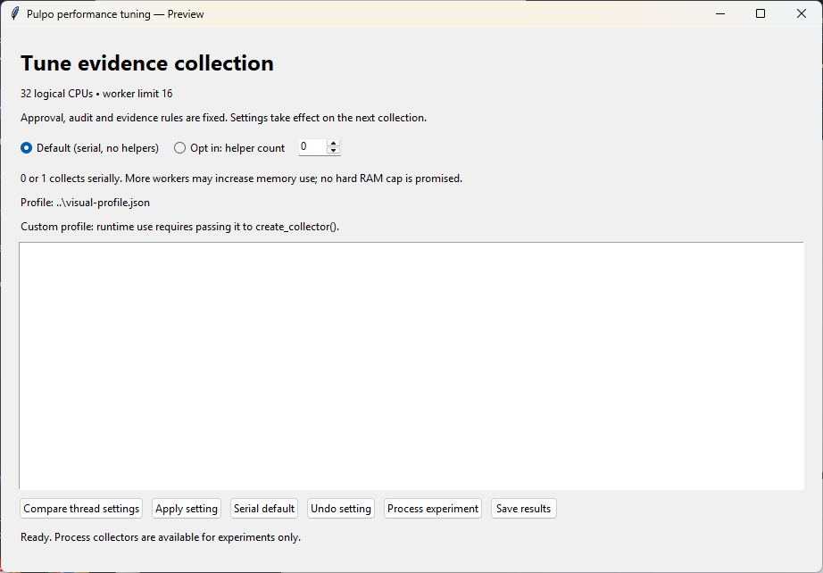
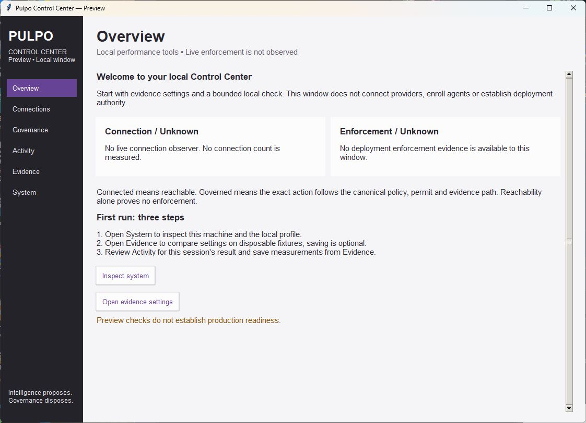
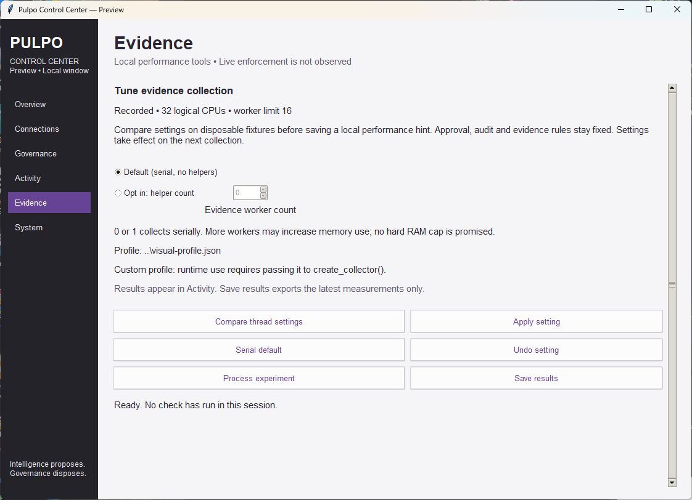
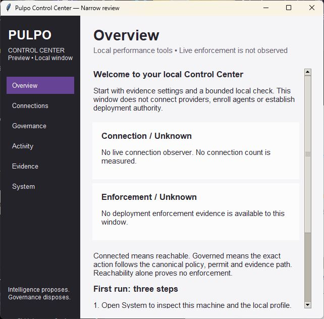

# Control Center review evidence

Claim classification: **Verified** for the bounded tests and Windows visual
observations below. **Unknown** for deployment enforcement, live connections,
and assistive-technology compatibility. Initial Ubuntu desktop rendering was
unqualified; the later [WSLg test record](WSL_GUI.md) verifies the local native
window, resizing and all 36 focused checks without skips.

Base: `ff2a4821035b62a99b31d5a4647b0dd4309d9954`.
This PR changes native presentation and test coverage only; authority and
canonical APIs remain unchanged. See [alternatives, boundaries and eight-pass
review](../CONTROL_CENTER_DESIGN.md).

## Visual review

The screenshots are native captures, not mockups. Before: existing 920 x 610
tuning window. After: 1120 x 780 Control Center and 640 x 600 minimum-size
overview. Content dimensions exclude the Windows frame.






Observed: both Unknown statuses stay independent; purple active navigation;
soft white cards; no startup benchmarks or saves; narrow cards stack and scroll;
Evidence is reachable with Alt+5. The first visual pass exposed premature text
wrapping; main-content resize observation corrected it before final captures.

## Reproduction

Windows Python 3.12.10 / Tk 8.6, bundled runtime:

```text
python -W error -m unittest tests.test_control_center tests.test_evidence_tuning tests.test_setup -v
python -m pulpo.cli tune --gui-check
```

All **36 tests pass without skips**; GUI construction passes. The local harness
sets `TCL_LIBRARY` and `TK_LIBRARY` to the bundled runtime's tcl8.6/tk8.6 folders.
The new cases verify no writes on repeated navigation/refresh; missing,
malformed, oversized and stale profiles; bounded session text; keyboard page
selection; narrow reflow/scroll; successful fixture comparison without saving;
failed comparison and recovery; explicit validated save. Tests use temporary
profiles and fixtures, never canonical user state.

Ubuntu WSL / Python 3.14.4:

```text
python3 -W error -m unittest tests.test_control_center.ProfileObservationTests tests.test_evidence_tuning tests.test_setup tests.test_kernel tests.test_persistence tests.test_governed_effect_boundary tests.test_constitutional_sequences -v
python3 scripts/run_pulpo_tests.py --suite core --log-dir ../linux-core-results
```

The focused run passes **77 tests** without skips. The broad core run reports
**689 tests, six skips, no assertion failures**; its stricter runner nevertheless
**fails** because three unraisable ResourceWarnings appear (an HTTPError cleanup
and two SQLite finalizers). Four skips require graphical Tk, two require Windows
handle/reparse behavior. Do not report this full-suite gate as green.

The untouched-base archive also reproduces all three warnings, but four other
tests fail because an archive lacks required Git history. That first comparison
is a harness limitation, not a product regression. A Git-backed local clone also
reproduces the same three warnings; its run reports 678 tests, two skips and one
class-setup error because its historical freeze object could not be read.
Therefore this baseline comparison establishes reproduction of the warnings,
not a clean full-suite baseline. No unrelated transport/database fix is included.

Raw focused logs and the broad core transcript/runner summary are adjacent.
Source hashes are in `source-hashes.json` and use normalized staged Git blobs.
These checks do not establish live policy enforcement, credential custody,
provider containment, production readiness or a full packaged Ubuntu GUI.
