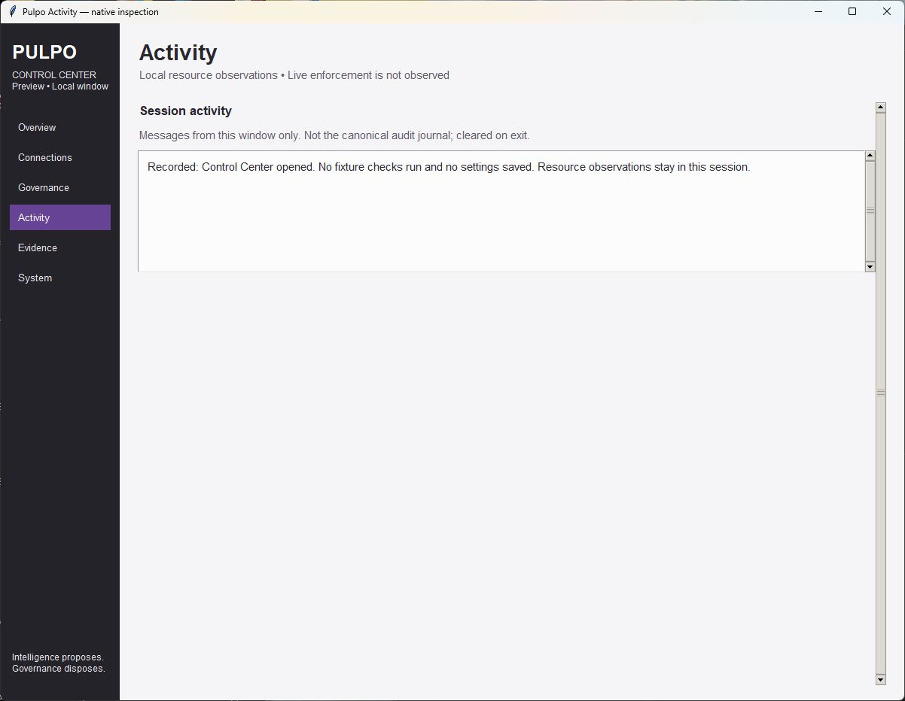
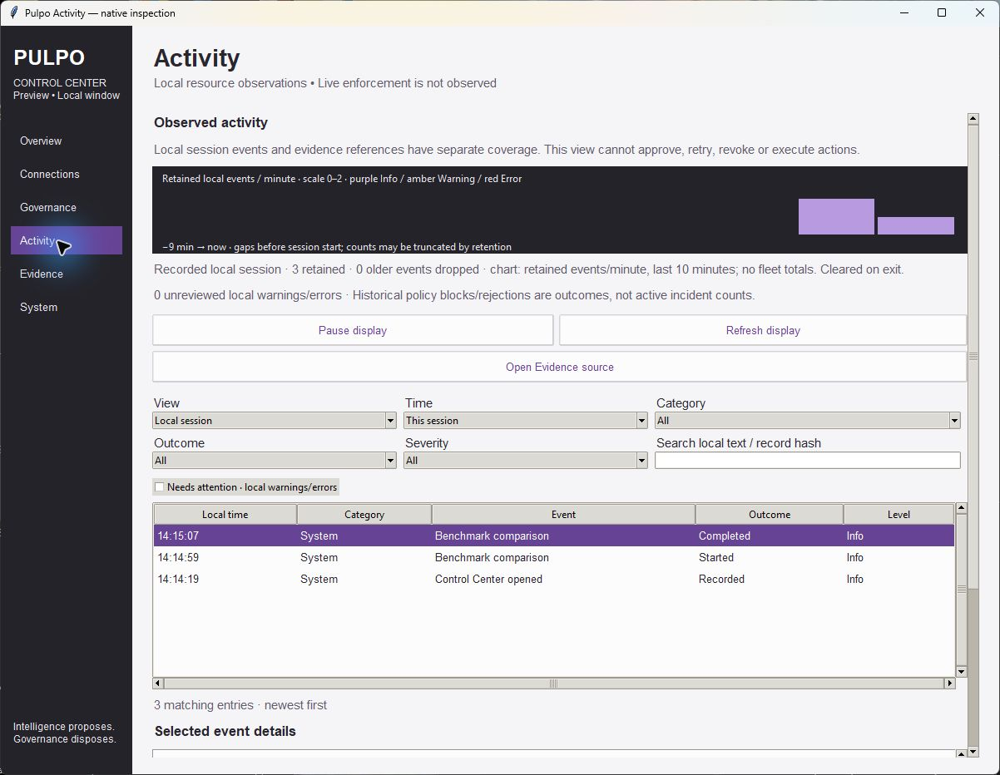
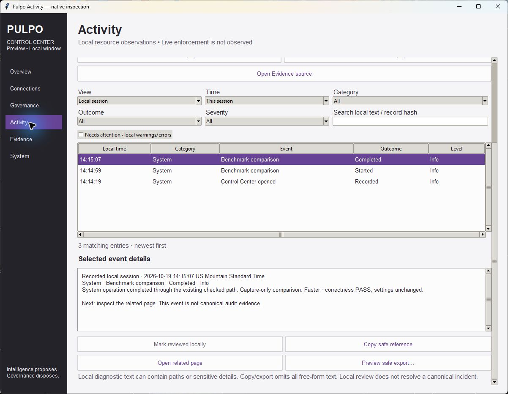
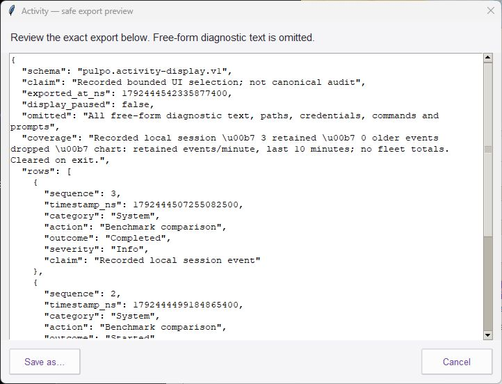
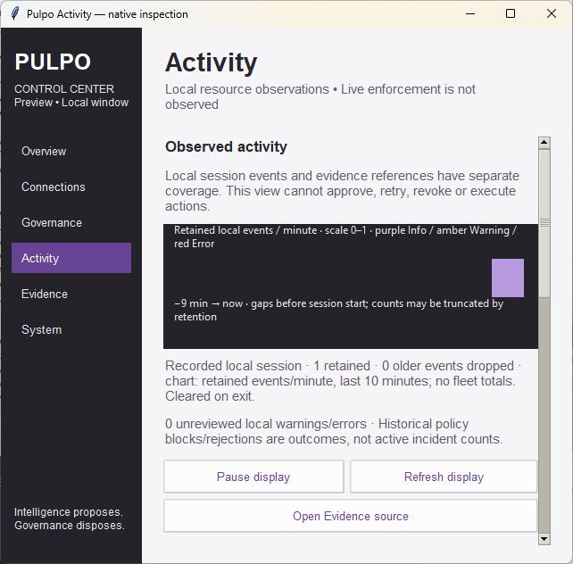
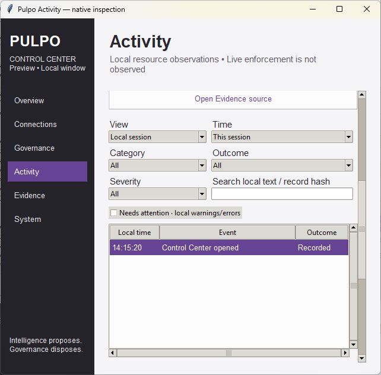
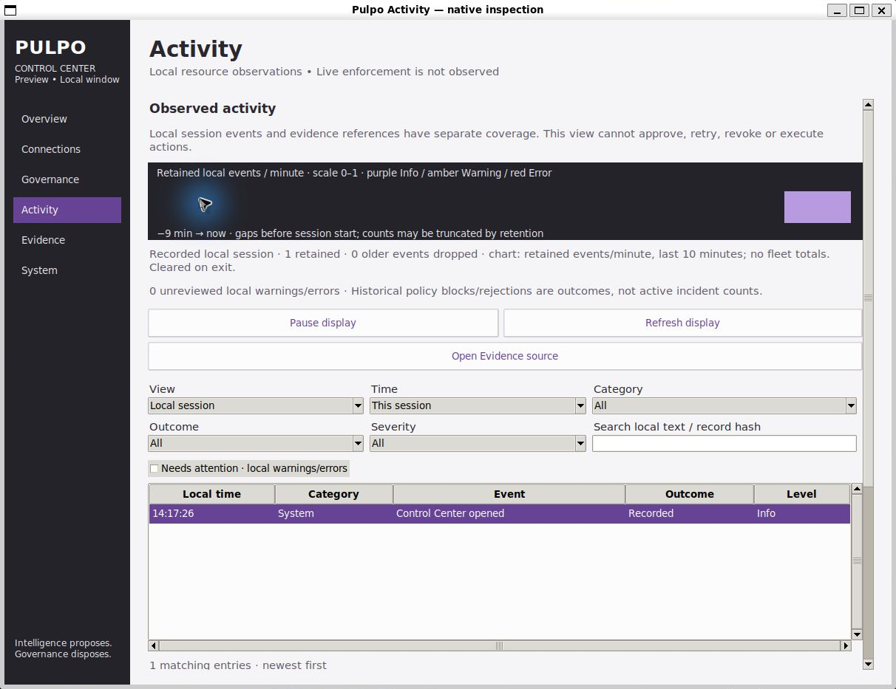
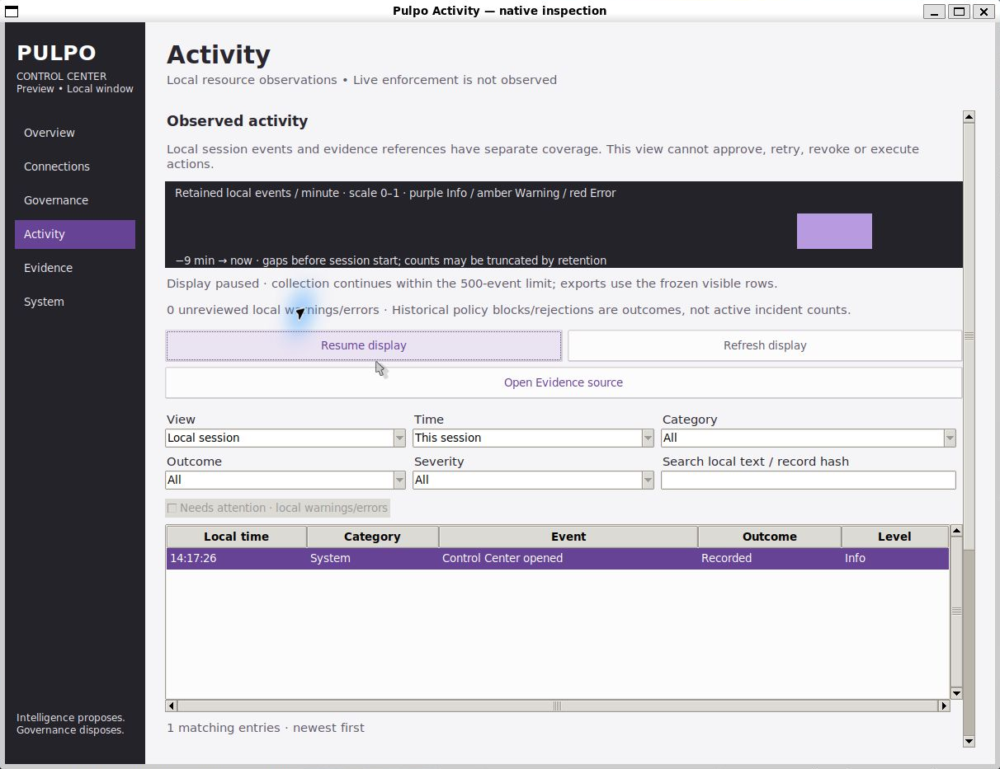

# Activity review evidence

**Recorded**, 2026-10-19. Base: `2f09d6e1e112ea011202e0c63f3185efe5250b83`.
LF-normalized source hashes bind the reviewed implementation in `source-hashes.json`.

## Native inspection

These are screenshots of the actual Tk UI, not mockups or sample dashboards.
No production profile was saved and no fabricated event metrics were injected.

| Before, Windows | After a real disposable comparison, Windows |
| --- | --- |
|  |  |

The actual Windows comparison emitted Started and Completed events, passed
correctness and reported Faster for its capture-only workload. Activity did not
apply settings. The feed distinguishes that bounded result from canonical audit
evidence or deployment enforcement.

The readonly export preview contains the exact metadata document that Save as
would write. Free-form diagnostic bodies are omitted entirely. Native inspection
opened the preview without saving; automated tests exercised save/cancel/frozen
payload and verified exclusion of a sensitive test marker.

| 640×600 monitor | 640×600 filters and event list |
| --- | --- |
|  |  |

Checked page scrolling, two-column filters, compact time/event/outcome columns,
horizontal table scrolling, selected event details and lower export controls.
Keyboard Page Down remained available. An evidence-reference view without a
selected valid source stayed empty; no historical activity rate was fabricated.
The final default time preset reads **Available coverage**, replacing the earlier
**This session** wording visible in these inspection images, so the label also
describes a source index that can include older references.

| Ubuntu WSLg | Ubuntu paused display |
| --- | --- |
|  |  |

WSLg rendered successfully in this run. These images are cropped only to the
native window boundary to remove unrelated desktop content. Inspection confirms
the page renders and pause disables filters/refresh; it does not explain or claim
a fix for the earlier environment's copy-mode rendering issue. Windows images
retain their native window boundary as captured.

## Tests

- `windows-focused.log`: Python 3.12.14; **50 tests, OK, no skips**.
- `ubuntu-focused.log`: WSL Ubuntu, Python 3.14.4; **50 tests, OK, no skips**.
- `ubuntu-core.log` and `ubuntu-core-summary.json`: **769 tests, OK, two skips**;
  the skips require Windows handle-sharing/reparse traversal. Zero resource
  warnings; the runner treats warnings as errors.

Added coverage checks bounds/eviction, metadata rejection, search/filter/time
ordering, observed histogram counts, omitted free-form exports, pause/unread,
exact preview payload despite later arrivals, cancelled export, local review
preserving failure outcomes, reference scope/freshness, duplicate-free refresh,
no Activity file reads and no authority conclusion. Existing native lifecycle,
Evidence, System comparison/cancel/save/restore and legacy launch tests pass.

Source references and failure cases in automated tests use explicitly scoped
fixtures; no production event completeness, authenticated provenance, provider
request history, canonical incident resolution or enforcement is established.

See [Activity design and required change record](../../ACTIVITY_TIMELINE.md) for
authority boundaries, eight-pass review, limitations and temporal-transfer scope.
