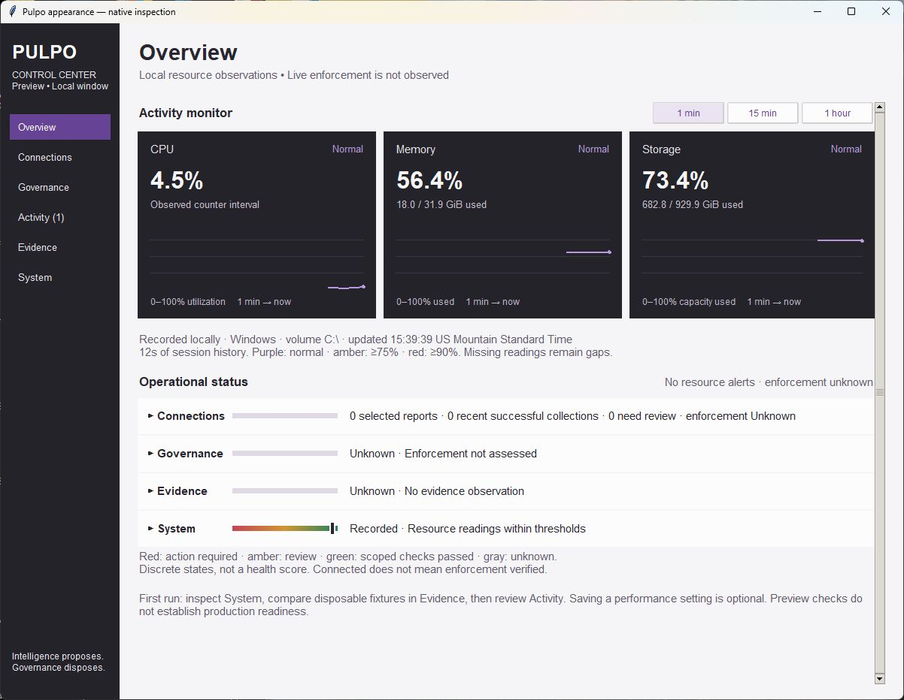
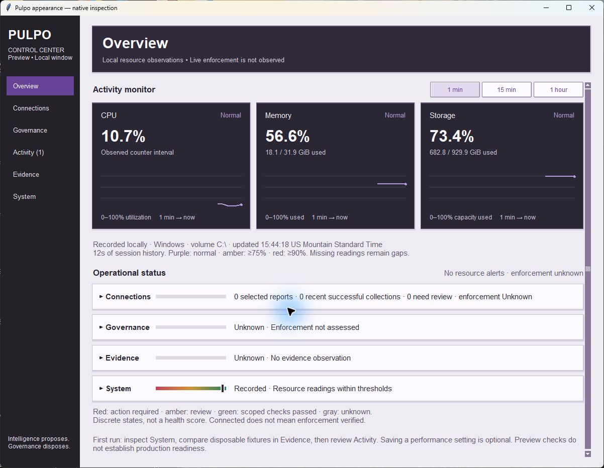
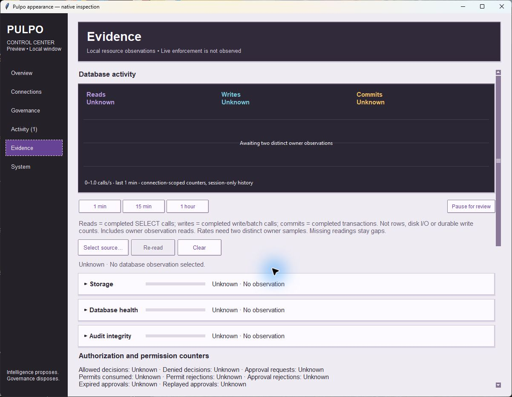
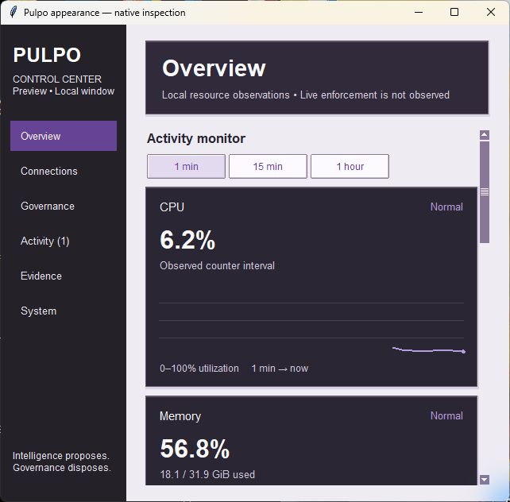
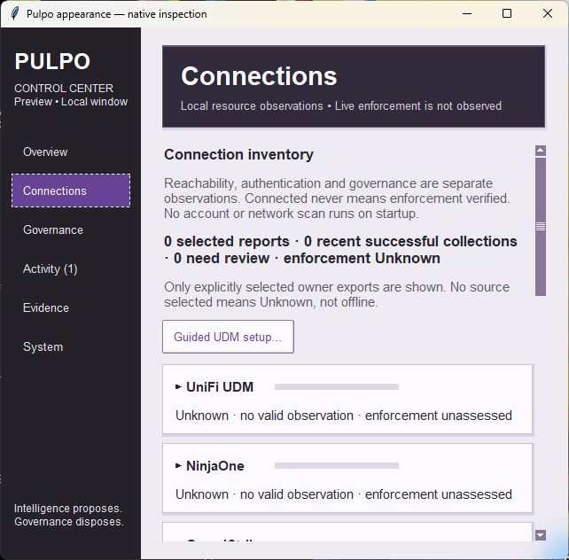
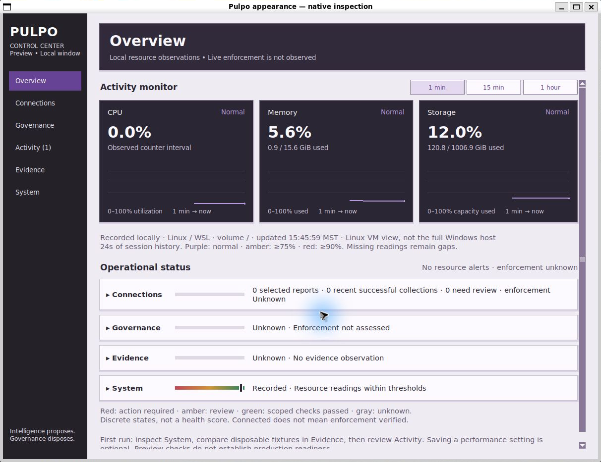
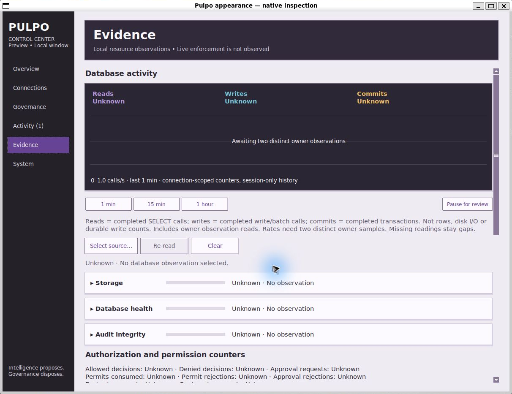

# Control Center appearance evidence

**Recorded**, 2026-10-19. Base: `fb382ba7b2a763896c2dfbc48c3ccc387da2853f`.

## Native inspection

| Before | Glass-inspired opaque layers |
| --- | --- |
|  |  |

| Minimum-size Overview | Minimum-size Connections |
| --- | --- |
|  |  |

Windows inspection covered all six pages, the UDM guide inputs/tabs, keyboard
page shortcuts, visible focus, minimum-size chart stacking, status-row wrapping
and Page Down to lower guidance. Final captures show the stronger scrollbar
contrast introduced after the initial inspection.

Actual native Tk captures, with no injected readings, statuses or fake evidence.
Ubuntu captures are cropped only by the capture tool's 32-pixel outer padding to
the native window boundary, removing unrelated desktop content. WSLg rendered
successfully during this increment; this does not retroactively change the earlier
UDM increment's incomplete visual inspection record. No extension, desktop theme,
certificate or OS setting was installed or changed. Resource values are independent
real session observations, not a before/after performance benchmark.

## Automated checks

- `windows-focused.log`: Python 3.12.14, **62 tests, OK**.
- `ubuntu-focused.log`: Python 3.14.4, **62 tests, OK**.
- `ubuntu-core.log` / `ubuntu-core-summary.json`: **781 tests, OK, two
  Windows-only skips**, zero resource warnings. Warnings treated as errors.
- `contrast.json`: **21 checked pairs pass**; text/chart-label threshold 4.5:1,
  control-border/scrollbar threshold 3:1. This is numeric sRGB checking, not
  accessibility certification. Decorative edges and grid lines are not covered
  as text or standalone controls.
- `source-hashes.json` binds LF-normalized source and exact test-log bytes.
  The local `.gitattributes` preserves log bytes. Local paths in the core summary
  are redacted; its core-log hash still matches the retained log.

Existing tests exercise observation/authority distinctions, malformed and stale
reports, benchmark cancellation/save/restore, graph gaps, filters, explicit site
selection, repeated navigation, minimum-size reflow and Tk teardown. Production
readiness, full accessibility, performance improvement and enforcement are not
established. See the [scope and required change record](../../CONTROL_CENTER_APPEARANCE.md).
