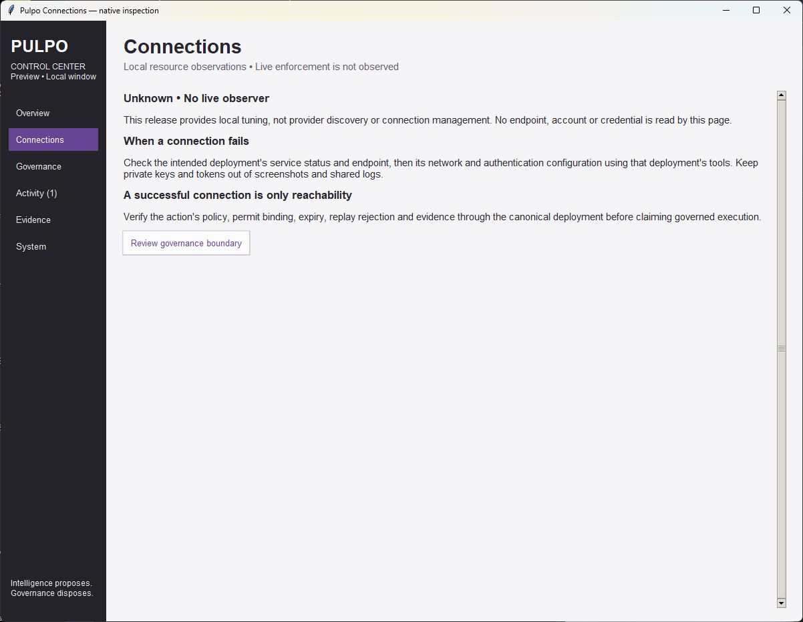
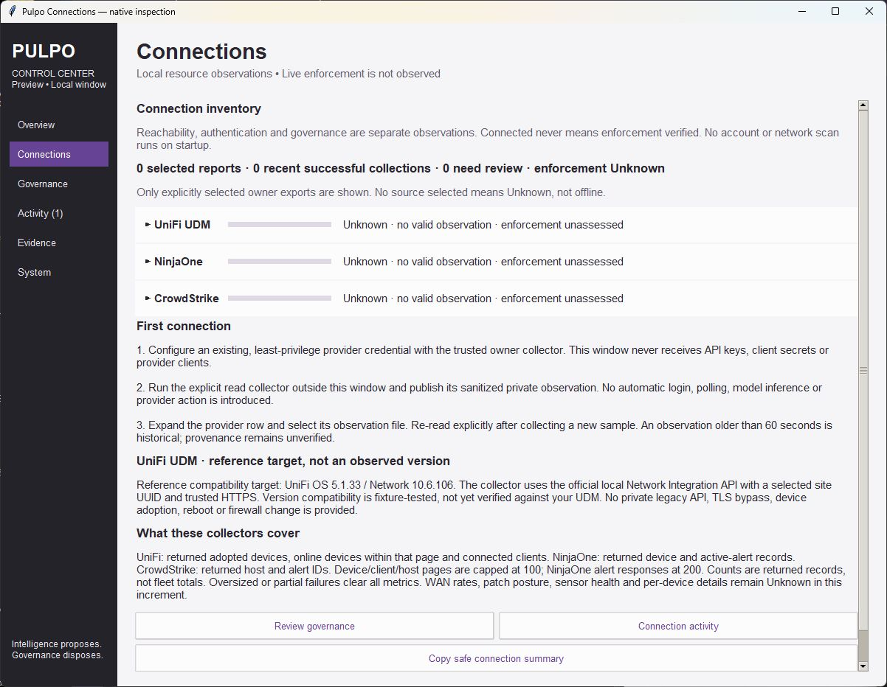
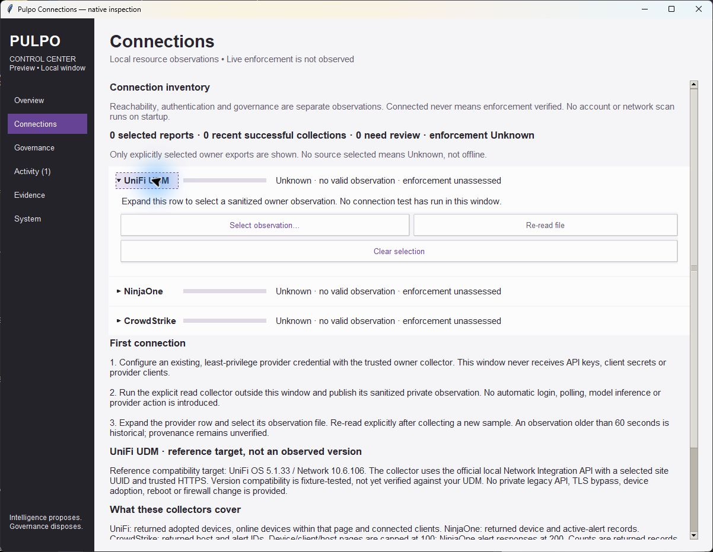
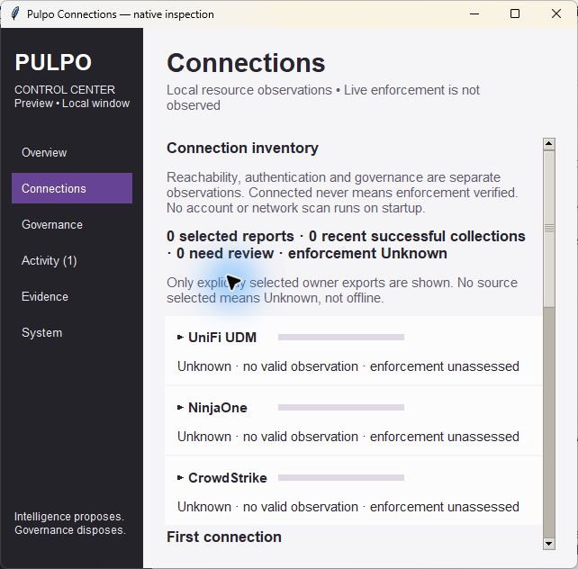
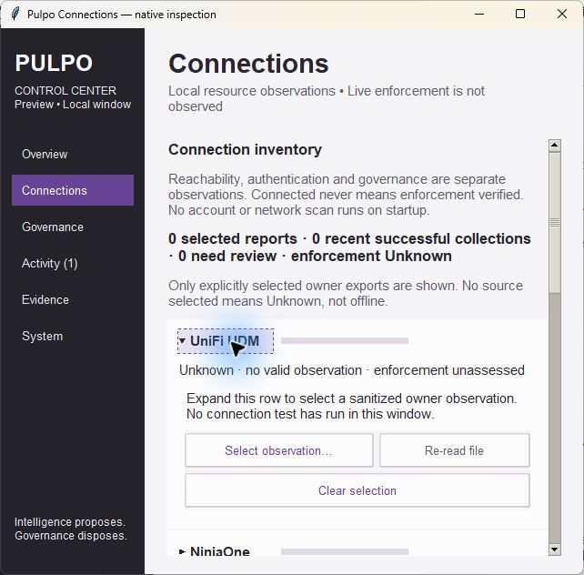
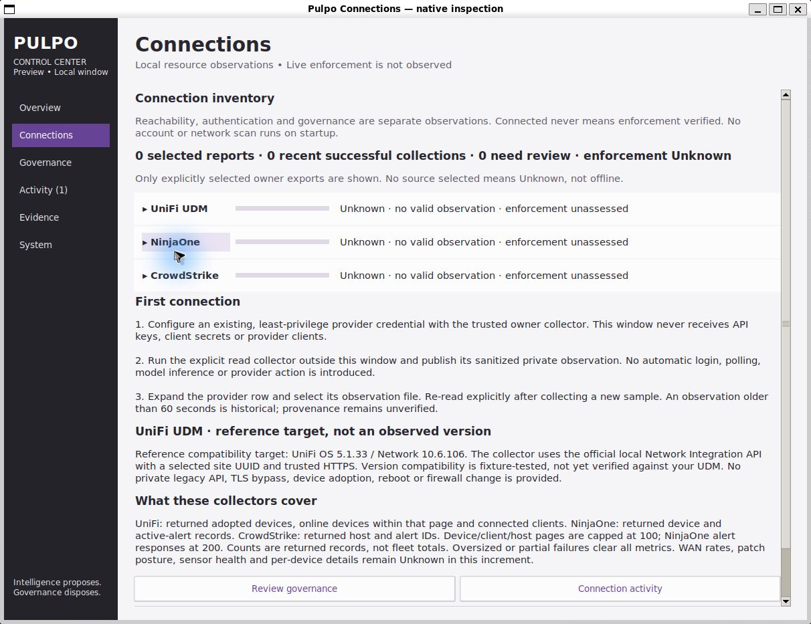

# Connections and provider collector evidence

**Recorded**, 2026-10-19. Base: `41d7bab56d0c0c46d55efffc2844f813196db992`.
Source hashes use UTF-8 with LF-normalized line endings. Public API-spec hashes
bind the UniFi 10.6.106 and NinjaOne documents inspected during implementation.
No real provider credentials, private account data or live device metrics are
included in these artifacts. No live API collection was attempted.

## Native inspection

Actual Tk screenshots, with no fabricated connected state or injected metrics:

| Before, Windows | New connection inventory, Windows |
| --- | --- |
|  |  |

All three providers correctly remain Unknown without a selected observation.
The zero summary values count this window's selected reports/collections, not
provider device or alert totals. UDM version numbers are labeled reference
compatibility targets, not measured versions. Inspected expandable rows,
observation selection/re-read/clear controls, first-run guidance, and links to
Governance/Activity. No credential-entry or provider execution control exists.

| Minimum width | Expanded UDM at minimum width |
| --- | --- |
|  |  |

Checked stacked summaries, wrapped guidance, reachable controls and keyboard
Page Down to lower content. Native accessibility/screen-reader qualification is
not established by visual inspection.

Ubuntu WSLg rendered successfully. This screenshot is cropped only to the native
window boundary to remove unrelated desktop content.

## Automated evidence

- `windows-focused.log`: Python 3.12.14; **56 tests, OK, zero skips**.
- `ubuntu-focused.log`: Python 3.14.4; **56 tests, OK, zero skips**.
- `ubuntu-core.log` / `ubuntu-core-summary.json`: **775 tests, OK, two Windows-only
  handle-sharing/reparse traversal skips**, zero resource warnings.
- Warnings treated as errors. Existing Activity, System benchmark/cancel/save/
  restore, Evidence tuning and Tk lifecycle regressions pass.

Collector tests use explicit mocked transports and public-shaped fixtures:
fixed UniFi device/client routes; bounded returned counts; no names/IPs/keys in
exports; Ninja monitoring scope; CrowdStrike Hosts/Alerts reads; permission
failure after partial success clearing all counts; malformed/missing tokens;
401 authentication reporting; invalid origins/site UUID; redirects, compression,
oversized bodies, duplicate keys and non-finite JSON rejection; fixed-route write
rejection before transport construction; private atomic export/read; invalid
schemas, secret fields, boolean counts and future timestamps rejected.

UI tests verify independent authentication/enforcement text, stale/invalid and
wrong-provider clearing, unchanged-report deduplication, no timer-based file
reads, safe summary copy, file bytes unchanged, Activity category linking and
timer shutdown when hidden. No kernel authority is gained by these results.

These checks do not prove real tenant entitlement, credential grants, live TLS
trust, installed UDM behavior, production performance, or governance enforcement.
See [setup, scope and required change record](../../CONNECTION_CONNECTORS.md).
