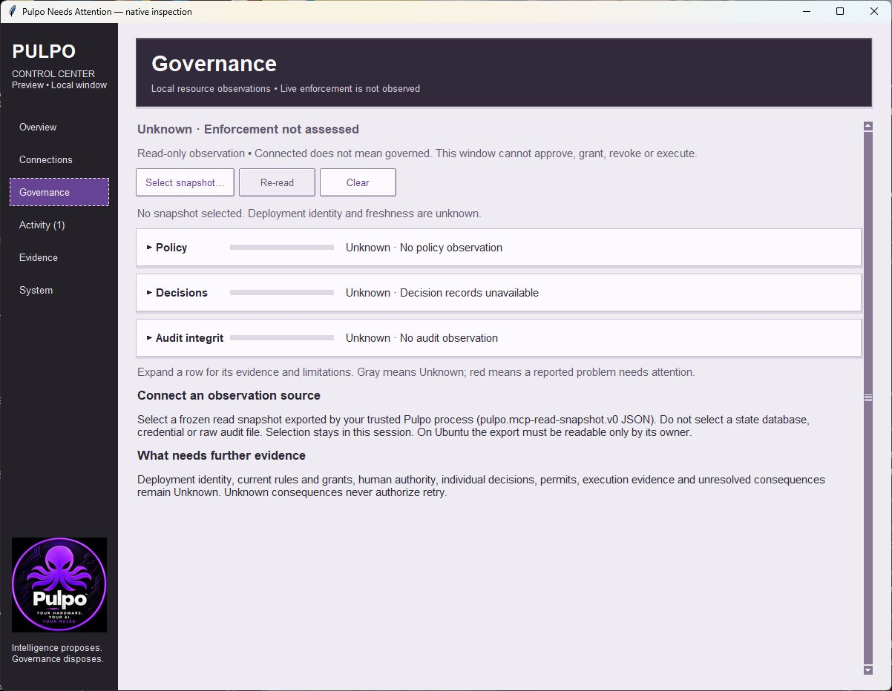
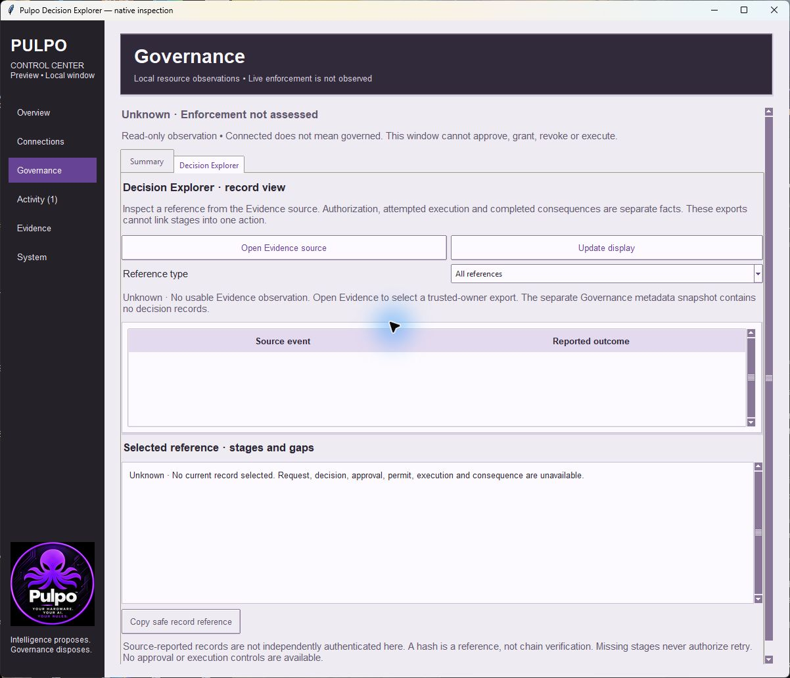
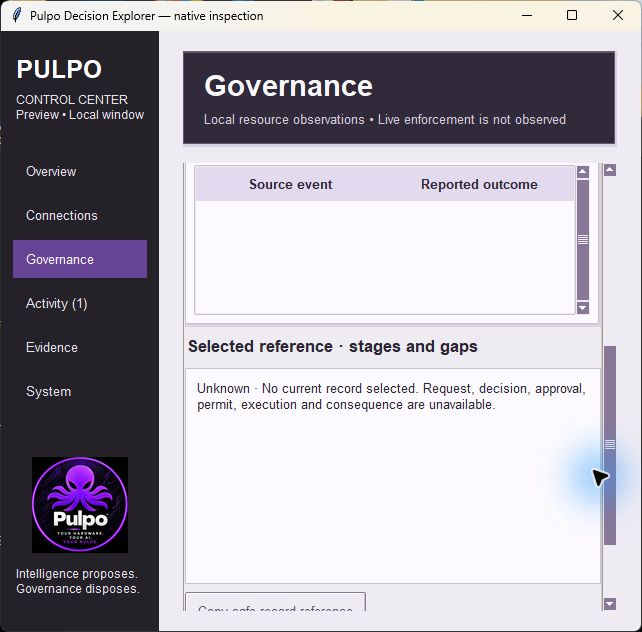
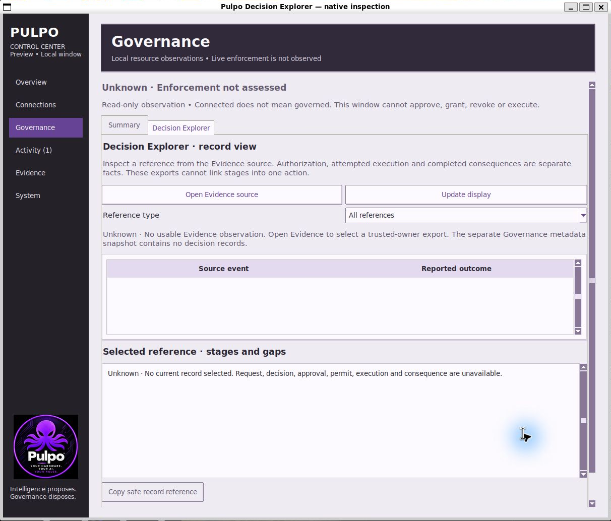
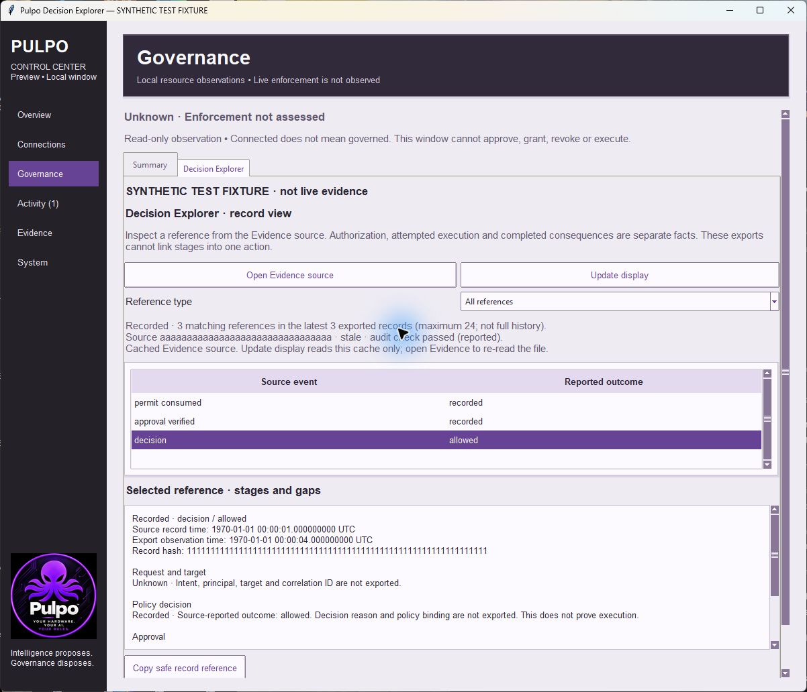
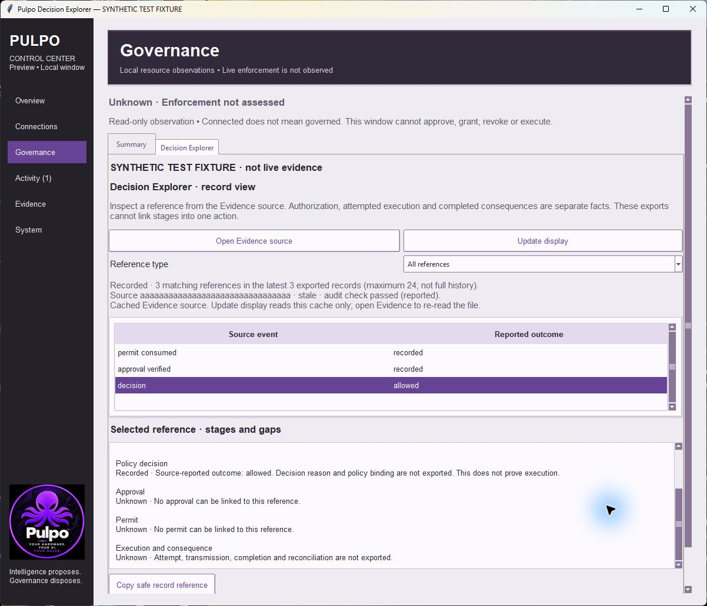

# Decision Explorer review evidence

**Recorded**, 2026-10-19. Base: `efe9239` (merged Needs Attention). The manifest
records the full base SHA, LF-normalized changed-source hashes and exact log bytes.
No live provider credentials or private canonical state were inspected.

| Prior Governance summary | New Decision Explorer tab |
| --- | --- |
|  |  |

Actual native Windows captures, using the existing theme and unchanged APIs. The
before capture is from the merged base; the after view has no Evidence source and
correctly shows Unknown. Window heights differ; this is not a layout/performance
benchmark or historical authority replay.

The 640×600 minimum client area retains sidebar navigation, a fitting two-column
table, keyboard page scrolling and a separately scrollable detail pane. Native
automated tests verify explicit arrow-key selection after loading references.

The Ubuntu image is cropped only to the native window boundary, removing capture
padding/desktop. Other Windows captures retain their complete window boundary.
This is not full accessibility or every-desktop qualification.

## Explicitly synthetic selected-record demonstration

These two native captures are **SYNTHETIC TEST FIXTURE**, prominently labeled in
both the window title and content. They are not live operational evidence. The
fixture is the same three-event structure exercised by
`test_decision_explorer_uses_cached_records_without_linking_neighbors`: a decision
with outcome allowed at 1 second after epoch, an approval_verified reference at
2 seconds, and a permit_consumed reference at 3 seconds. Source is 32 `a`s,
record hashes are 64 repeated digits `1`, `2`, `3`, and observation time is
4 seconds after epoch. No raw payload, authority object or file is loaded or
created; only frozen public observation values are set in the test harness cache.

Selecting the decision fills only its reported outcome. Approval, permit and
execution/consequence stay Unknown despite the neighboring references. The source
is correctly stale, its audit pass is explicitly reported, and enforcement stays
unassessed. The lower-stage image scrolls the same selected record's detail text.

## Automated evidence

- `windows-focused.log`: **79 tests, OK; one POSIX FIFO check skipped**.
- `ubuntu-focused.log`: **79 tests, OK**.
- `ubuntu-core.log` / `ubuntu-core-summary.json`: **796 tests, OK; two Windows-only
  skips**, zero resource warnings. All suites treat warnings as errors. Local
  paths in the summary are redacted; its core log hash still matches exact bytes.
- `source-hashes.json`: changed production/test source and exact log hashes.
  The local `.gitattributes` preserves Windows log line endings.

New tests cover all decision outcomes, unlinked neighboring approval/permit
references, other/directive event coverage, nanosecond UTC times and contract
bounds, current-cache-only navigation, source substitution before copy, invalid
source precedence, clearing and returning records, filter changes even when the
same row remains, safe copy fields, no file creation, minimum-width keyboard
review and root teardown. Existing Evidence, Activity, Connections, UDM setup,
resource, system benchmark and core authority regressions are included.

The retained evidence does not prove source authenticity, complete action chains,
independent chain verification, deployed governance enforcement or an external
consequence. See [scope, change record and eight-pass review](../../DECISION_EXPLORER.md).
