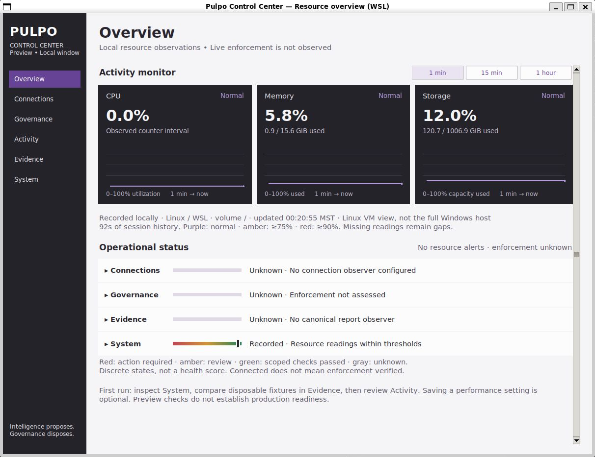
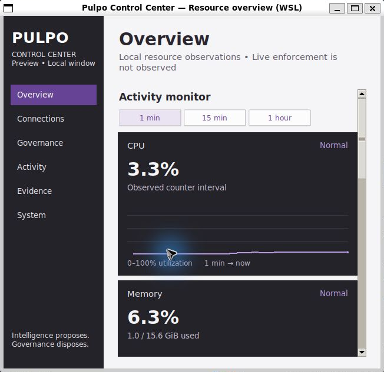
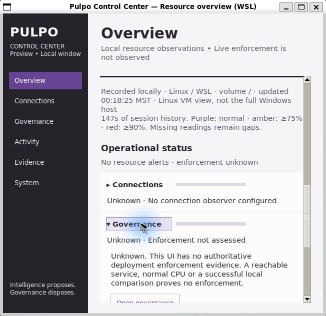

# Native resource overview evidence

Base: `655b110` (merged Control Center lifecycle fix). Authority unchanged;
no canonical state mutation or API change. The full scope and eight-pass review
are in [Native resource overview](../../NATIVE_RESOURCE_OVERVIEW.md).

## Verified bounded checks

- Ubuntu WSLg / Python 3.14.4: **51 focused tests pass, zero skips**.
- Windows / Python 3.12.10 / Tk 8.6: **51 focused tests pass, zero skips**.
- Final full Ubuntu core: **704 tests, two Windows-only skips, no assertion
  failures**. The strict runner nevertheless **fails on three pre-existing
  ResourceWarnings**: HTTPError cleanup and two SQLite connection finalizers.
  This gate is not green. Its summary and full transcript are included.
- Real WSLg layout inspected at 1200 x 900 and 640 x 600, including stacked
  graphs, separate narrow time controls, keyboard paging and row expansion.
- The manual preview used a separate absent profile. It remained absent after
  sampling, time-range changes, scrolling and expansion. Existing fixture
  comparison, failure recovery and explicit temporary-profile saves are covered
  by the focused suite. Window-owned timers are cancelled on destruction.

```text
python3 -W error -m unittest tests.test_local_resources tests.test_control_center tests.test_evidence_tuning tests.test_setup -v
python3 scripts/run_pulpo_tests.py --suite core --log-dir ../resource-core-final-results
```

The same focused command ran with the bundled Windows Python; its Tcl/Tk
library environment points to the bundled tcl8.6/tk8.6 directories.

Regression cases cover aggregate CPU counter deltas and guest-time exclusion,
warmup/zero/reset/unavailable intervals, bounded malformed input, MemAvailable
semantics, unavailable storage, threshold boundaries, session-history bounds,
graph gaps, range selection, hidden-page pause, and independent Unknown
connection/governance/evidence state under both healthy and failing resources.
Narrow-layout assertions verify that time-range controls fit their parent.

## Native captures

These are real local readings, not mockup sample values or benchmark results.
Captures are cropped to the application window to exclude the surrounding
desktop; their application content is unaltered. WSL capacity/CPU/memory refer
to the Linux VM view, not the entire Windows host.





## Limits

Verified describes the bounded test and rendering observations. OS telemetry is
Recorded. Deployment governance, canonical evidence status and connections
remain Unknown; normal resource usage supplies no authority or enforcement
proof. Other Linux desktops, screen readers, all scaling factors, hour-long
soak behavior and a packaged Linux release are not qualified by these checks.
No merge, deployment or live provider action was performed.

`source-hashes.json` binds the source/test files and logs using normalized staged
Git blob bytes. Earlier evidence elsewhere remains historical, not overwritten.
