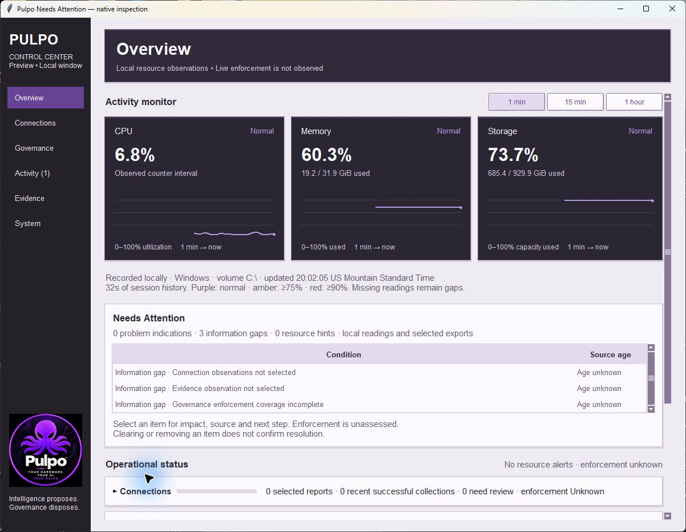
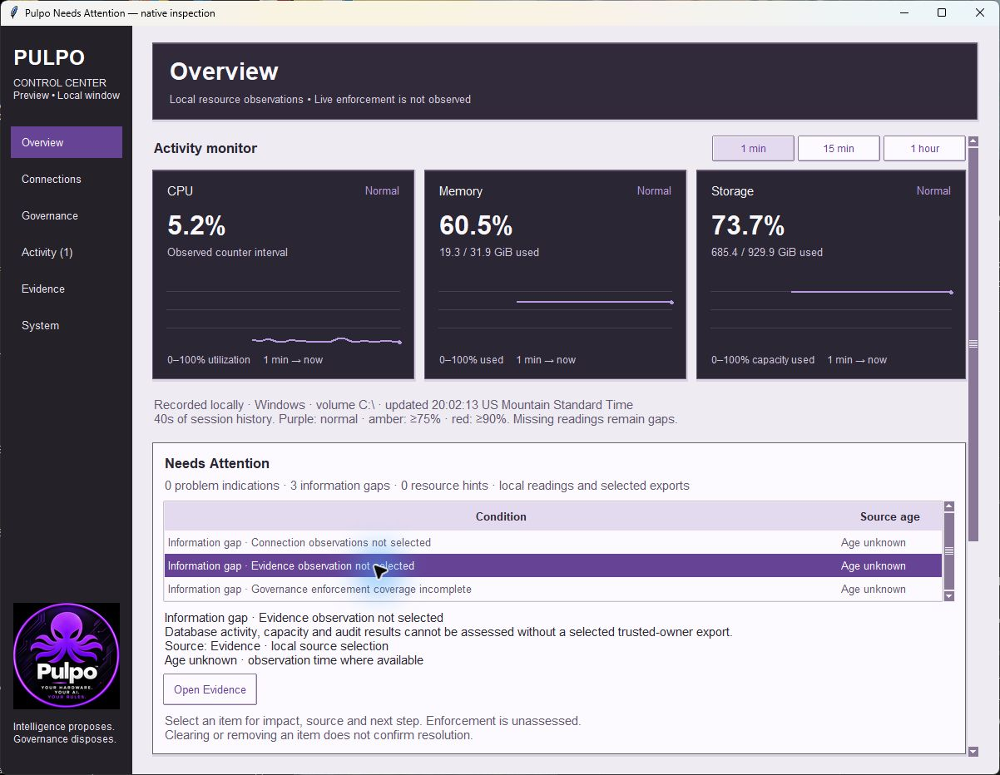
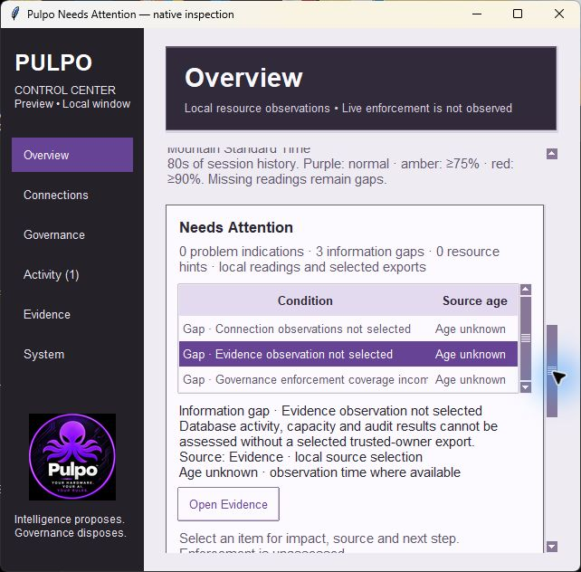
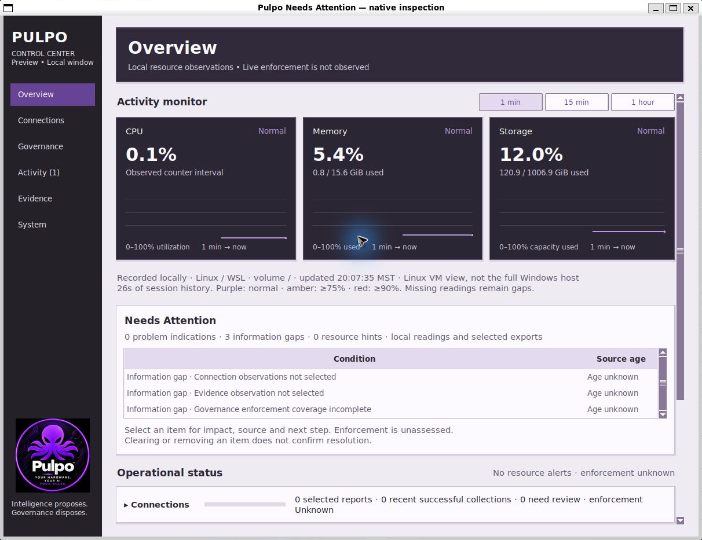

# Needs Attention review evidence

**Recorded**, 2026-10-19. Exact base and LF-normalized source hashes are in
`source-hashes.json`. No live provider credentials or invented metrics are used.

| Before | Needs Attention below the existing monitor |
| --- | --- |
|  |  |

The prior screenshot was captured at `eeb337cc0ec49ff5fef5432269720e2f3dd6b578`;
its application UI matches the merged base of this change. It is a before view,
not a historical authority replay or before/after performance benchmark.

Actual native Tk captures. Source gaps are correctly gray and not reported as
incidents. Resource readings are actual independent OS samples in their labeled
environment. No fake provider success/failure or populated metrics were injected
for screenshots. Inspected detail selection, fixed-page navigation, keyboard
scrolling, wrapping and minimum-size layout. Ubuntu capture is cropped only to
remove the native capture tool's outer padding. This is not an accessibility
certification or every-desktop qualification.

## Automated evidence

- `windows-focused.log`: **70 tests, OK**, warnings treated as errors.
- `ubuntu-focused.log`: **70 tests, OK**, warnings treated as errors.
- `ubuntu-core.log` / `ubuntu-core-summary.json`: **789 tests, OK, two Windows-only
  skips**, zero resource warnings. Local paths in the summary are redacted; the
  retained core log still matches its original byte hash.
- `source-hashes.json` binds current LF-normalized source and exact log bytes.
  The local `.gitattributes` preserves Windows log line endings.

New model tests cover first-run gaps versus problems, source-reported TLS/failure
and fixed actions, stale success, missing health/capacity, audit/database failures,
existing resource/WAL thresholds, cumulative workflow/error totals excluded from
incidents, invalid-source precedence over old samples, arbitrary strings not
echoed, unknown governance time, local scope, future clocks and bounded repeatable
projection. UI tests cover cached-only navigation with loaders forbidden, age
refresh retaining selection without duplicate rows, clearing a source disabling
the old action with a non-resolution notice, minimum-width fit and cleanup.
A removed key returning also stays inactive until explicitly selected again.

Existing Connections, Evidence, Activity, benchmark, UDM setup and authority
regressions remain in the suites. These tests do not establish source authenticity,
live service/fleet coverage, unresolved-consequence state, production readiness or
governance enforcement. See [rule scope and eight-pass change record](../../NEEDS_ATTENTION.md).
