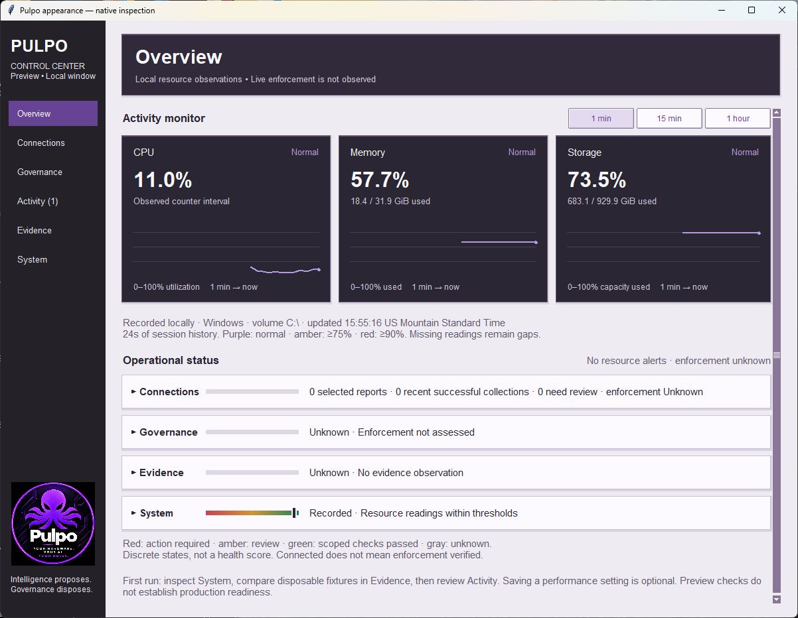
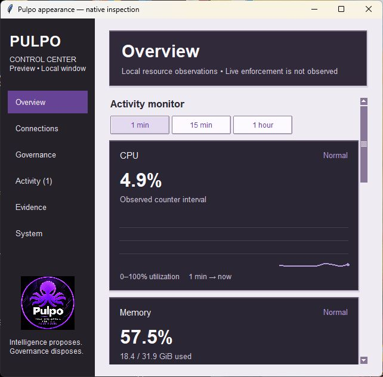

# Sidebar badge follow-up

**Recorded**, 2026-10-19. Increment from appearance commit
`d623501515724663dc326bca85cdf2f613b4622a`, for the user-requested logo placement.

The initial placement captures and checks below bind commit
`c75e66ef3161149424be30827e8bf14e6f16e11e`. Its pixel-skipping display scaling is
superseded by the [anti-aliasing follow-up](antialias/README.md).

Actual Windows Tk captures at 1200×900 and 640×600. The logo is centered above
“Intelligence proposes. Governance disposes.”, preserves the supplied image's
aspect ratio and contents, and shrinks in short windows to keep navigation clear.
Screenshots contain independent real local resource readings, not fixture metrics.

`package-check.json` records byte-for-byte preservation of the user-supplied PNG
and its presence in a successfully built application wheel. No runtime dependency
on the original Downloads path or new image-processing library is introduced.
The full-resolution asset is retained unchanged; display scaling uses Tk's native
subsampling. Small text within the badge is correspondingly reduced.

- `windows-ui.log`: **15 existing UI tests, OK**, warnings treated as errors.
- `ubuntu-ui.log`: **15 existing UI tests, OK**, warnings treated as errors.
- The lifecycle regression now also verifies the cached logo image is released
  when the root closes, before later worker garbage collection. Existing navigation,
  minimum-size layout, authority labels, source failures, benchmarks and UDM guide
  checks pass. The full core suite was not repeated for this decorative addition;
  the earlier theme validation remains bound to its recorded commit.
- `source-hashes.json` binds this increment's source and exact UI-log bytes.

Authority and canonical state mutations: unchanged / none. The only new file read
is a fixed packaged decorative image; there is no credential, provider, executor,
desktop setting or canonical writer introduced. Missing image data is nonfatal.
Existing APIs and actions are retained. No enforcement, authenticated connectivity,
production-readiness or full accessibility claim follows from logo placement.
No historical replay or reusable authority lesson is claimed. The original theme
eight-pass review remains applicable; this addition conveys branding, not status.
