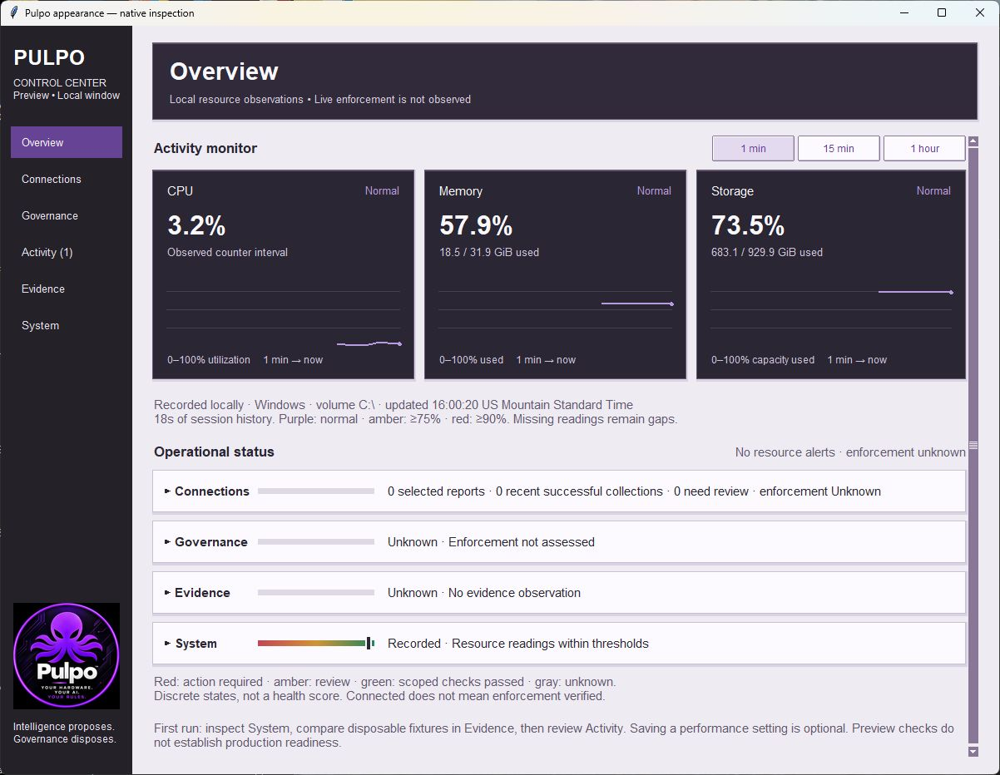
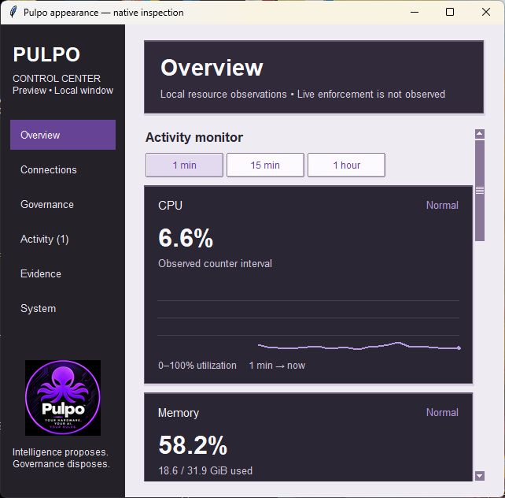

# Anti-aliased sidebar logo

**Recorded**, 2026-10-19. Follow-up to initial logo placement commit
`c75e66ef3161149424be30827e8bf14e6f16e11e`.

Actual Windows Tk captures at 1200×900 and 640×600. The original high-resolution
PNG is preserved. Two bundled 96- and 128-pixel derivatives use Pillow's Lanczos
resampling, replacing Tk's pixel-skipping subsampling. The application loads the
prepared PNGs at their exact size; it does not import Pillow or resize on each
redraw. The same placement, short-window choice and UI-thread cleanup remain.
Tiny text is still limited by the small number of display pixels.

`scripts/prepare_sidebar_logo.py` regenerates only the two derivatives from the
fixed packaged original; Pillow is a preparation-time tool, not a runtime
dependency. `package-check.json` records source/derivative dimensions and hashes,
generator version and byte-for-byte inclusion in a freshly built wheel. The
original's hash remains unchanged.

- `windows-ui.log`: 15 UI tests pass, warnings treated as errors.
- `ubuntu-ui.log`: 15 UI tests pass, warnings treated as errors.
- Existing image cleanup, minimum-size reflow, navigation and observation-boundary
  regressions pass. The core suite was not repeated for image resampling.
- `source-hashes.json` binds current source, generated assets and exact UI logs.

This is a decorative rendering change. No API, authority, credential, canonical
mutation, provider operation or desktop setting changes. Evidence is Recorded;
visual polish proves no enforcement, performance improvement or full accessibility.
No temporal replay or reusable authority lesson is claimed. The existing
presentation-boundary review remains applicable.
