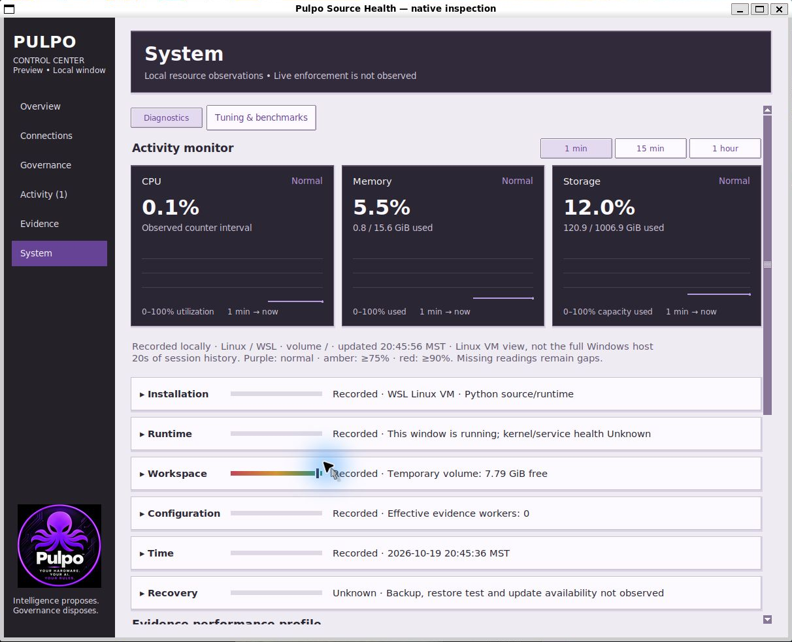
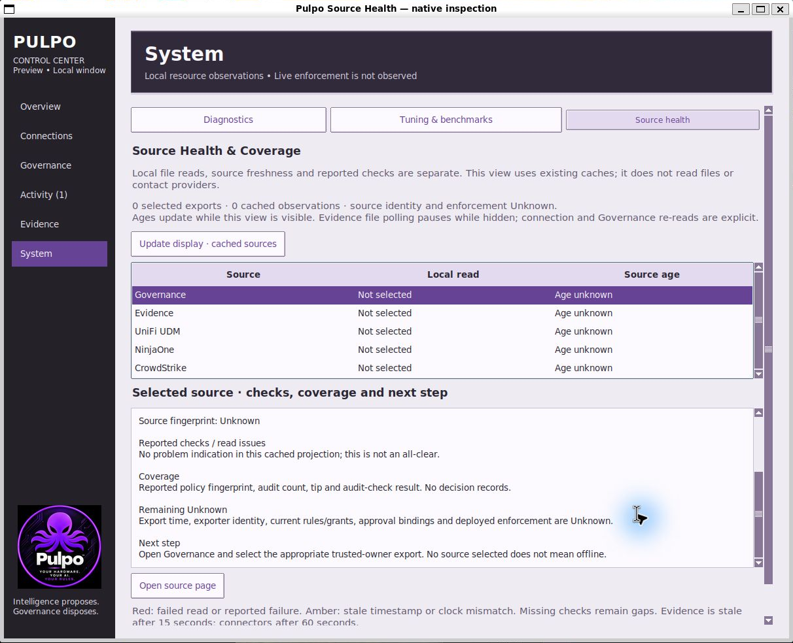
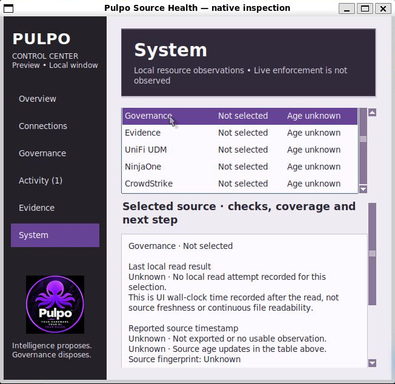
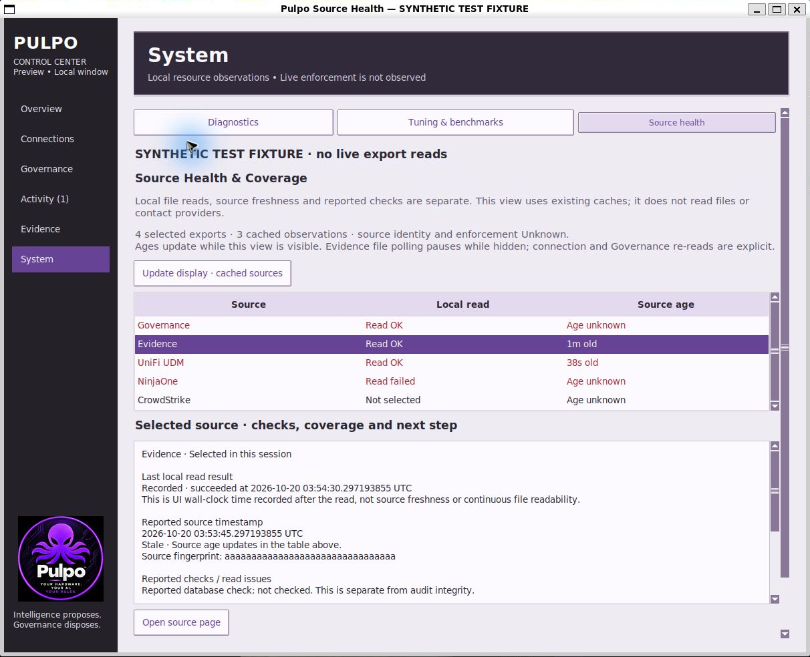
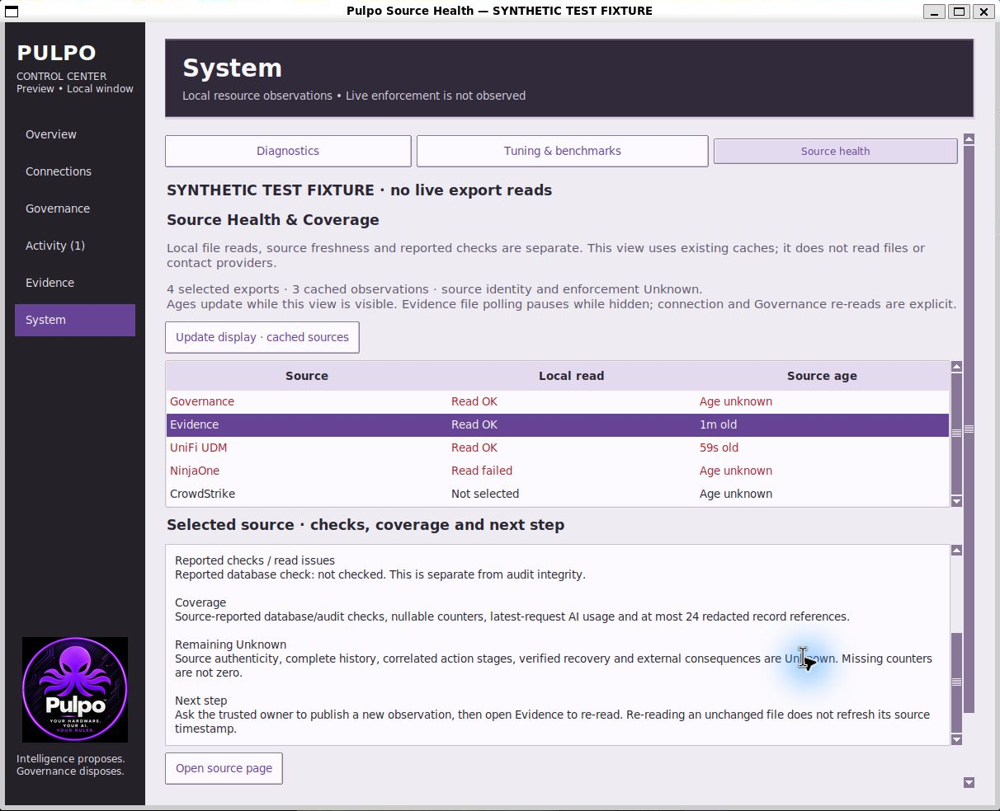

# Source Health WSL review evidence

**Recorded**, 2026-10-19. Exact base:
`c7afe7337045ccb02f6b2eaab86ce29c36aeb164` (merged Decision Explorer).
`source-hashes.json` binds changed production/test source and exact test logs.
This increment was tested and visually reviewed in Ubuntu WSL; no new Windows
qualification is claimed.

| Exact-base System view | New Source health view |
| --- | --- |
|  |  |

The baseline was launched from the exact merged Git state with only this change's
files temporarily shelved, then restored. It is a native visual baseline, not a
historical authority replay or performance benchmark. Its resource readings are
actual labeled WSL VM observations. The new view shows the real first-run state:
five unselected sources, no cached observations and unknown ages, with no external
source or provider data injected.

The selected, unconfigured Governance source explains its supported metadata,
missing export time/identity/rules/approval bindings/enforcement, and the next
setup step. No missing value is guessed or replaced by local read time.

Native inspection included the two-row System tab layout, fitting source table,
Page Down scrolling, selected details and a separate detail scrollbar. Automated
native tests cover explicit arrow-key selection and retaining the logical
paragraph under review when the source status changes. Captures are cropped only
to the native window boundary to exclude outer capture padding and desktop.
This is not complete accessibility or every-desktop qualification.

## Explicit synthetic fixture

These two captures are prominently labeled **SYNTHETIC TEST FIXTURE · no live
export reads**, both in the window title and application content. Frozen test
values are set in the existing caches without any file, database or provider read:

- Governance: selected, synthetic successful local read, reported audit failure;
  no export timestamp exists, so source age stays Unknown.
- Evidence: selected, synthetic successful local read at fixture creation time,
  source timestamp 45 seconds earlier, passing reported audit check, database
  check not performed, nullable counters/usage absent, zero references. The
  screenshot demonstrates stale source time independent of local read time.
- UniFi UDM: selected, synthetic successful local file read, report timestamp
  initially 10 seconds earlier and reported TLS failure; no provider metrics.
- NinjaOne: selected, synthetic failed local file read, no usable observation.
- CrowdStrike: unselected, Unknown rather than offline.

Source ages advance while displayed. No counters or live health metrics are
invented. The fixture's reported outcomes and local read results are simulations,
not evidence about a real deployment, database or provider. The lower screenshot
shows nullable telemetry coverage, remaining Unknowns and why republishing—not
re-reading an unchanged file—is needed for a newer source timestamp.

## Automated evidence

- `ubuntu-focused.log`: **90 tests, OK**, warnings treated as errors.
- `ubuntu-core.log` / `ubuntu-core-summary.json`: **807 tests, OK; two Windows-only
  skips**, zero resource warnings, warnings treated as errors.
- `source-hashes.json`: LF-normalized hashes for eight changed production/test
  files, exact log hashes and full base SHA. Local summary paths are redacted;
  the core log still matches its original byte hash.

New model cases cover first-run coverage, local read versus source age, missing
Governance time, failed versus missing database checks, TLS/permission reports
inside readable files, invalid-source precedence, sanitized errors/paths, stale
thresholds, future clocks, clearing and bounded repeated projection. Native UI
cases use actual owner-private temporary files to verify accepted reads, re-read
timestamps without fabricated freshness, invalid replacement, clearing, reported
audit failure inside readable metadata, and readable TLS-failure reports.
Cache-only navigation forbids all existing source loaders, checks fixed row counts,
timer cancellation and no new files. Layout/keyboard/paragraph/teardown cases also
pass. Existing authority, Evidence, Decision Explorer, Activity, Connections, UDM,
resources, benchmarks and other core regressions remain included.

These tests and captures do not prove source authenticity, continuous readability,
collector setup/uptime, full history/fleet coverage, clock sync, correlated action
chains, independent audit verification or deployed governance enforcement.
See [scope, required change record and eight-pass review](../../SOURCE_HEALTH.md).
