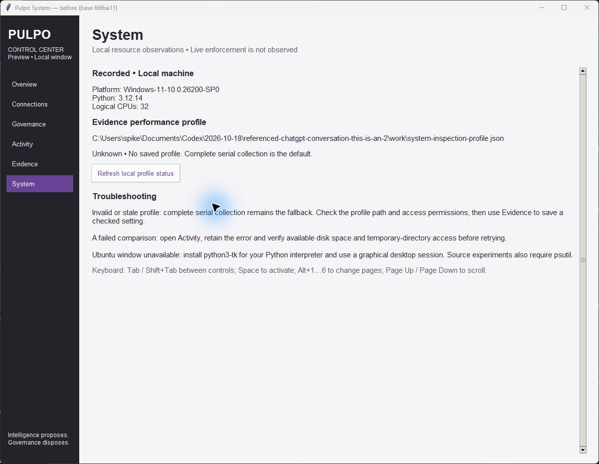
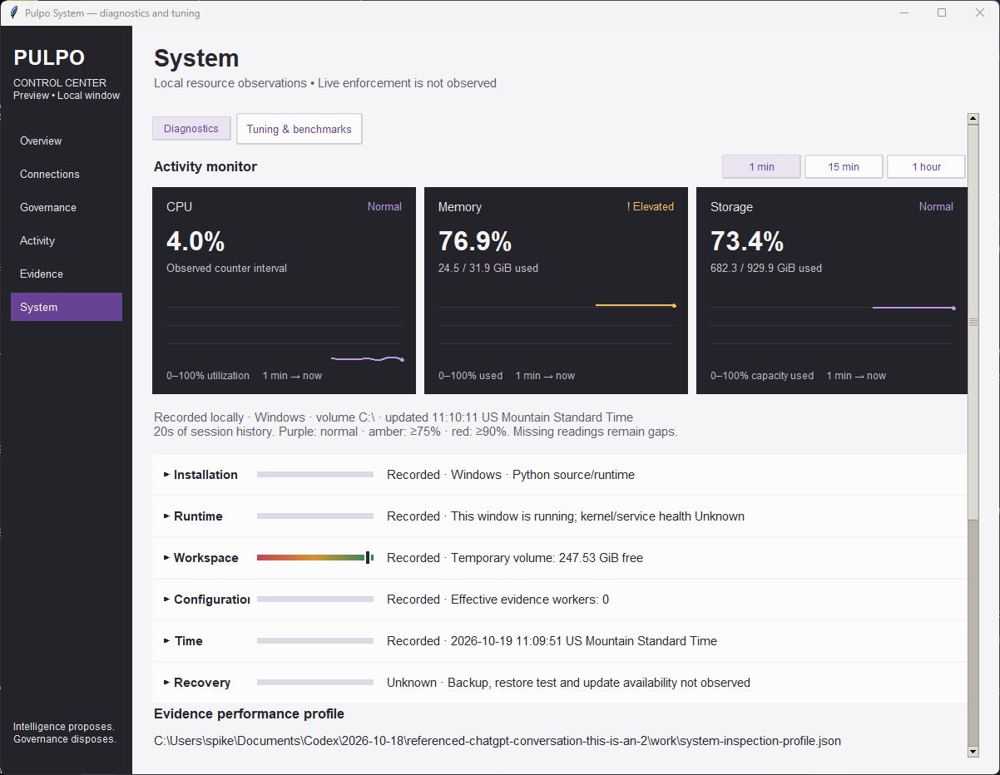
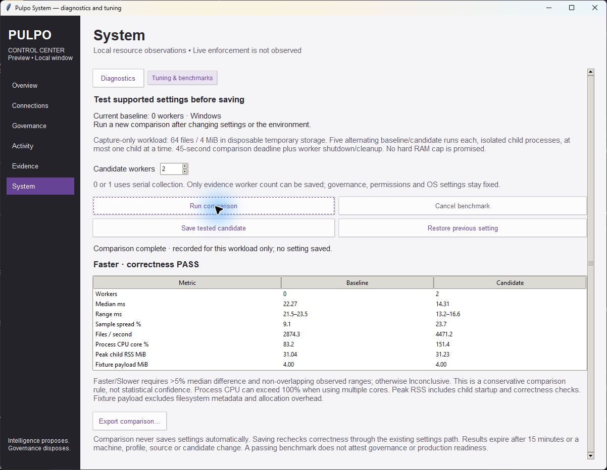
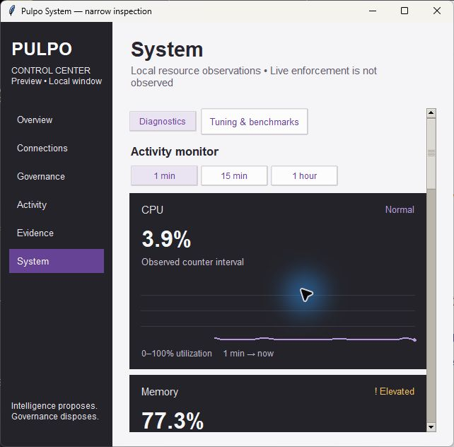
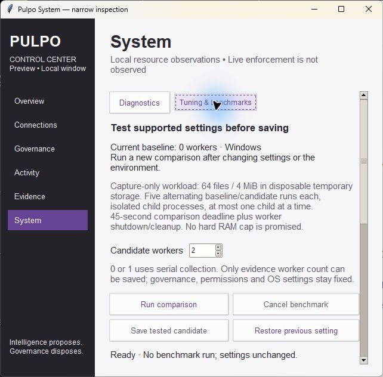

# System diagnostics and tuning review evidence

**Recorded**, 2026-10-19. Base: `66fba112134f98612a04e16f6af4b2bac91c7387`.
Source files are bound by LF-normalized SHA-256 in `source-hashes.json`.

## Visual inspection

All images are actual native Tk windows on Windows, not rendered mockups.
The before image uses the exact base presentation module in an isolated preview
process. No production profile was saved. Wide size: 1200×900 content;
narrow size: 640×600 content. Native window decorations add pixels.

| Before | Diagnostics |
| --- | --- |
|  |  |

| Narrow diagnostics | Narrow tuning |
| --- | --- |
|  |  |

Inspected graph colors and labels, six diagnostic rows, tab switching, progress,
result range/variation/CPU/RSS/payload, disabled save before completion, keyboard
Page Down and access to lower results/export controls at narrow width. WSLg
opened test windows but displayed transparent windows titled `[WARN:COPY MODE]`;
WSLg visual correctness is **Unknown**. No transparent-window captures are used
as successful visual evidence. Automated Tk tests did run under WSLg.

The Windows visual comparison recorded baseline 0 / candidate 2 workers:
22.27 / 14.31 ms medians, 21.5–23.5 / 13.2–16.6 ms observed ranges, classified
Faster for that workload only. No setting was saved. The independent real WSL
comparison in `wsl-comparison.json` recorded 4.31 / 8.43 ms medians and Slower.
Both passed correctness. These different outcomes are local observations, not
portable tuning guidance or evidence of production/governance performance.

## Regression evidence

- `windows-focused.log`: Python 3.12.14; **45 tests, OK, no skips**.
- `ubuntu-focused.log`: WSL Ubuntu, Python 3.14.4; **45 tests, OK, no skips**.
- `ubuntu-core.log` and `ubuntu-core-summary.json`: **764 tests, OK, two skips**;
  skipped tests require Windows handle-sharing and reparse traversal behavior.
  Zero resource warnings; warnings treated as errors by the test runner.
- Focused coverage includes real spawned measurement and cancellation,
  alternating order, timing classification, missing memory, correctness failure,
  deadline rejection, changed profile/expired report rejection, fresh save
  failure preserving bytes, explicit save/restore and first-save serial undo.
- Tk coverage includes diagnostics activation, redacted summary, mode switching,
  no automatic save, failure/cancel disabling save, old Evidence tuning behavior,
  and existing destroy/callback release regressions. The multi-window test
  harness now collects destroyed interpreter cycles on the owning UI thread.

See [scope and required change record](../../SYSTEM_DIAGNOSTICS_TUNING.md) for
resource limits, authority boundaries, eight-pass review and unsupported claims.
These artifacts do not verify a frozen application build, governance
enforcement, production database health, update availability or recovery.
