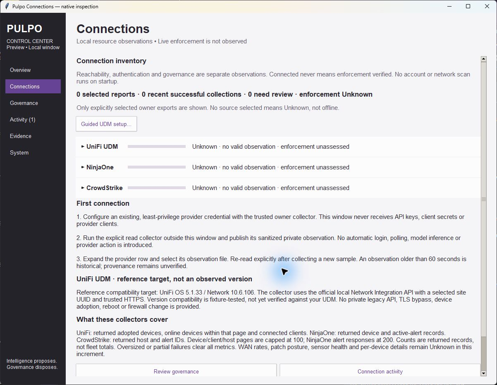
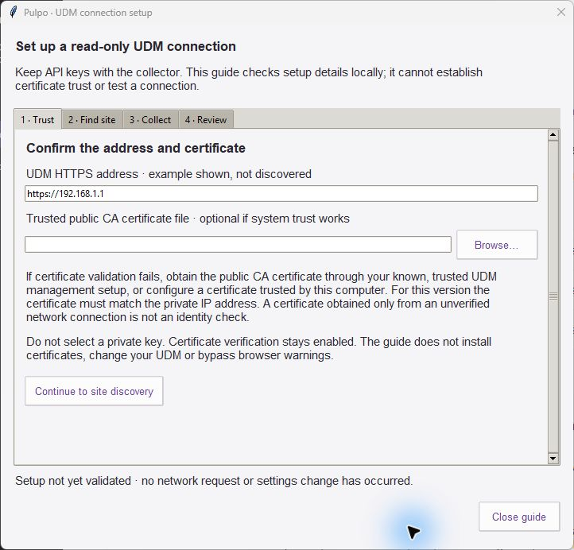
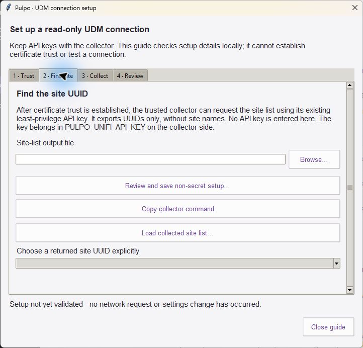
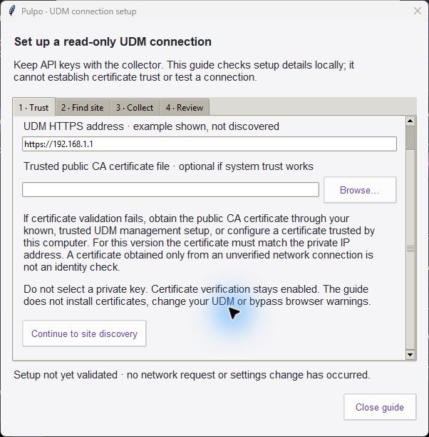

# UDM guided setup evidence

**Recorded**, 2026-10-19. Base `c24ff8763b99e0ea57c54936ee4cf082a2d5d982`.
Incremental update to the native Control Center. No rewrite, merge or deployment.
No real API credential, returned site identifier or device metric is included.
All tests use fixtures; no live authenticated collection succeeded or was attempted.

## Native inspection

| Before (Connections at base) | Guided setup entry |
| --- | --- |
|  |  |

The base screenshot is retained from PR #29; its UI is unchanged at this base.
Summary zeros are this window's selected-report counts, not network inventory.

Actual native Tk captures. Guide fields show the documented example origin and
empty paths/site selection. No fabricated connection state or injected inventory.
Inspection checks wrapping, scrollbars, reachable controls and distinct trust /
discovery / collection / review steps. Visual checks are not screen-reader
certification. Ubuntu Tk regression tests pass, but the separate native visual
check is incomplete: WSLg windows were exposed as `[WARN:COPY MODE]` and the
desktop capture tool returned unrelated screen content after window activation.
Those captures are deliberately not retained as UI evidence.

## Automated evidence

- `windows-focused.log`: Python 3.12.14, **62 tests, OK**.
- `ubuntu-focused.log`: Python 3.14.4, **62 tests, OK**.
- `ubuntu-core.log` and `ubuntu-core-summary.json`: **781 tests, OK, two
  Windows-only skips**, zero resource warnings. Warnings treated as errors.
- `source-hashes.json`: LF-normalized source hashes; test-log hashes bind retained
  logs, whose exact bytes are preserved by the local `.gitattributes` rule.
  Local checkout paths in the core summary are redacted.

New checks exercise strict profiles, rejection of credential fields/invalid
origins, canonical UUID bounds, malformed responses, sanitized TLS/auth/permission/
timeout failures, fixed site-list route, stale reports, duplicate IDs, option
mixing, output clobber rejection, shell quoting, reviewed save, changed-field
rejection, explicit UUID choice, wrong-origin clearing and Tk teardown. Existing
Connections, Activity, System benchmark, Evidence and UI lifecycle checks pass.

## Live trust boundary

`live-tls-result.json` records one explicit unauthenticated TLS check with the
operator address omitted. Certificate validation failed before an HTTP API
request or credential was sent. No TLS bypass, certificate installation, API-key
creation or provider configuration change occurred. The operator reports no
trusted CA file or known site UUID. An error at this boundary does not establish
API incompatibility or compromise.

Live API compatibility, actual credential grants, installed versions, source
provenance, production readiness and enforcement remain **Unknown**. No temporal
replay or reusable historical lesson is claimed. See the [setup guide and required
eight-pass change record](../../UDM_GUIDED_SETUP.md) for authority boundaries and
the smallest next live proof after trust is independently established.
