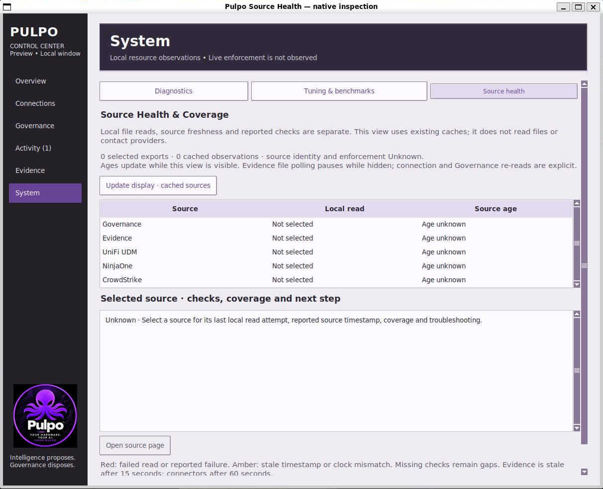
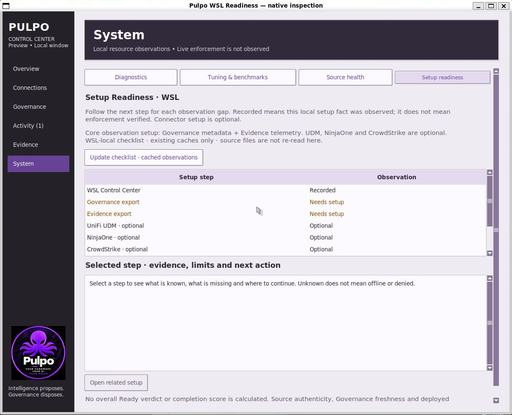
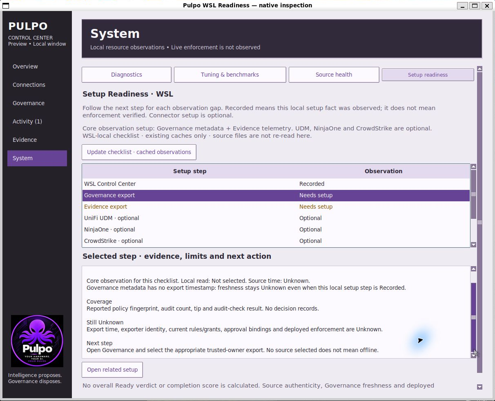
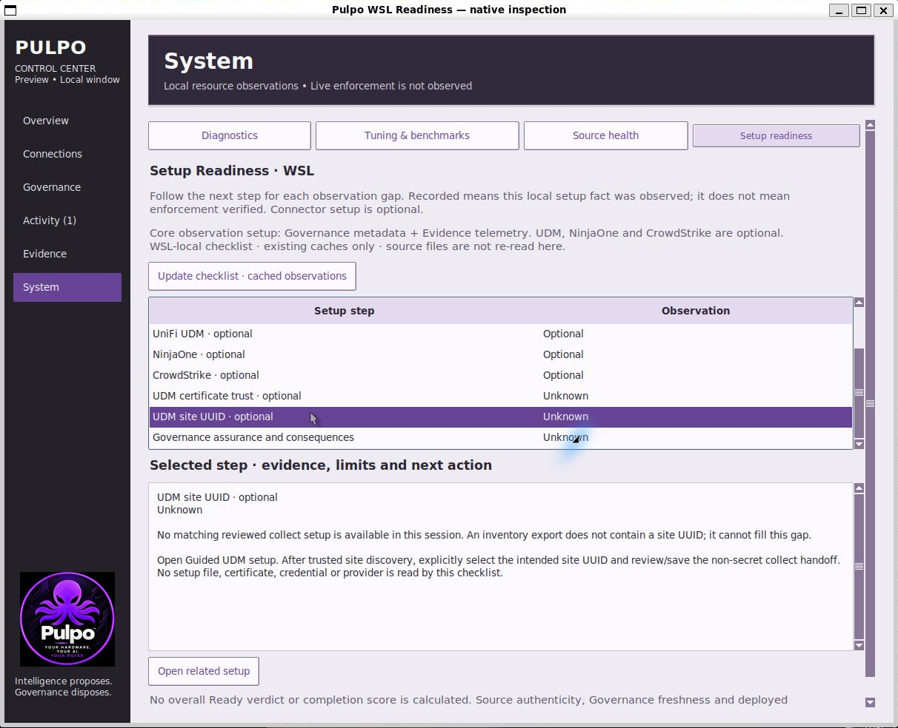
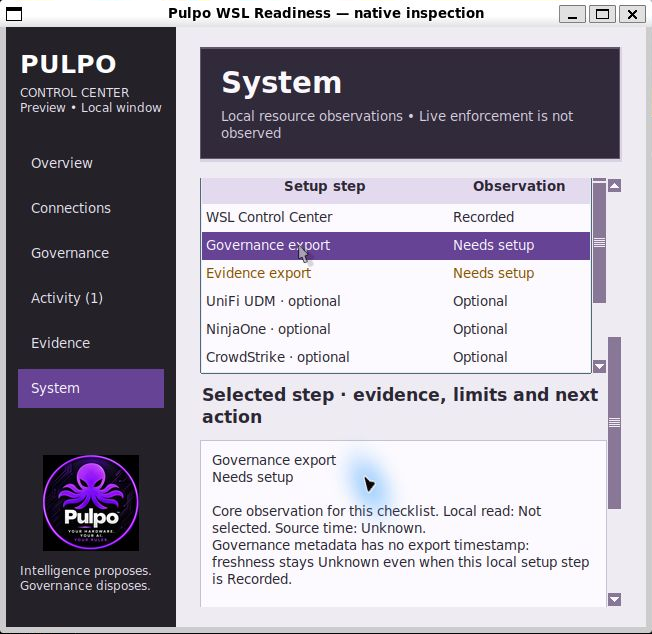

# WSL Setup Readiness review evidence

**Recorded**, 2026-10-19. Base: `8b6b33e` (merged Source Health).
`source-hashes.json` contains the full base SHA, changed-source hashes and exact
test log hashes. This feature is explicitly WSL-only.

| Prior WSL System view | New WSL-only checklist |
| --- | --- |
|  |  |

The prior native image was captured for `335e05f`. Its application code is
identical to the merged base of this change (`git diff 335e05f 8b6b33e -- pulpo`
is empty). It is a visual reference, not a historical authority replay or
performance comparison. No real provider or certificate checks were run for
these screenshots. No fixture metrics or status successes were injected.

All new images are actual native Ubuntu WSLg captures, cropped only to the
native window boundary to remove capture padding and desktop. Inspection
covered four wide/two-column narrow System tabs, first-run scopes, table/detail
scrolling, Governance next steps, UDM site/trust gaps, separate assurance and
minimum-size wrapping. These images are not complete accessibility certification.

## Automated evidence

- `ubuntu-focused.log`: **101 tests, OK**, warnings treated as errors.
- `ubuntu-core.log` / `ubuntu-core-summary.json`: **818 tests, OK; two Windows-only
  skips**, zero resource warnings, warnings treated as errors.
- `source-hashes.json`: LF-normalized changed production/test source and exact
  log bytes. Summary paths are redacted; the retained core log hash matches the
  original result. No Windows UI qualification is claimed.

New model tests cover Linux/WSL gating versus ordinary Linux/Windows/macOS,
first-run scopes, optional connectors, Recorded setup with Unknown assurance
and trust, readable unknown-result reports, stale/future/failing observations,
redacted error handling, source-reported TLS failures, matching reviewed non-secret
site handoffs without filesystem probes, changed/malformed/missing/closed guide
state. Native UI tests confirm no readiness tab when the WSL gate is false,
cache-only repeated navigation with all readers forbidden, fixed nine rows,
timer cancellation, Decision Explorer and UDM guide navigation, minimum-width
keyboard review and owner-thread teardown. Existing source/authority regressions
remain included in the complete core suite.

The evidence does not prove authenticated sources, certificate trust, site
access, collector setup/uptime, current deployment policy, complete action
chains, external consequences or governance enforcement. See [scope, required
change record and eight-pass review](../../WSL_SETUP_READINESS.md).
