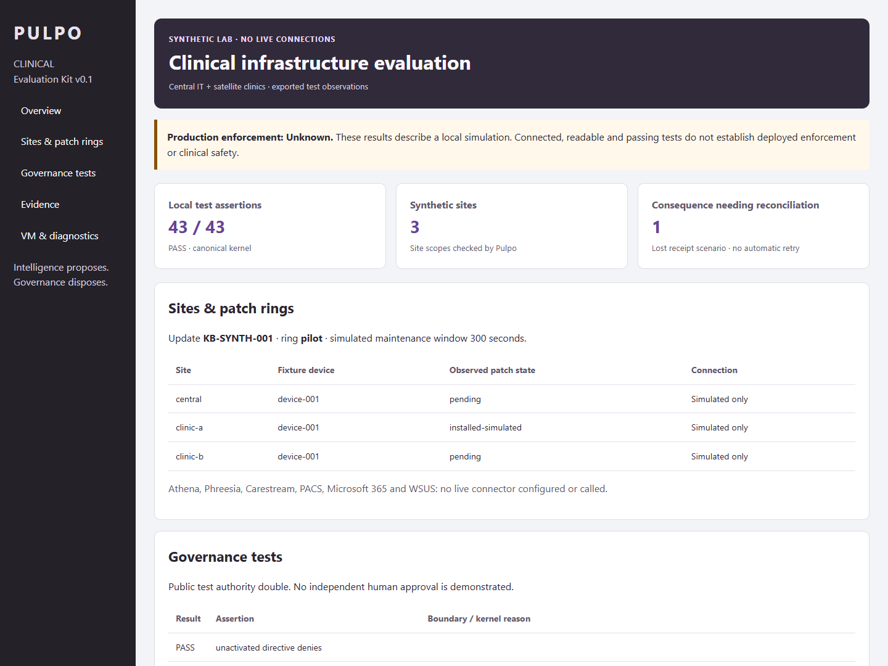

# Pulpo Clinical Evaluation Kit v0.1

Synthetic evaluation of central IT and satellite clinic governance. This directory is a **review package**, with no changes to the installed runtime, root kernel, adapters or production connections.

## Run the kit

Download [the evaluation ZIP](Pulpo-Clinical-Evaluation-Kit-v0.1.zip) and its [SHA256](Pulpo-Clinical-Evaluation-Kit-v0.1.zip.sha256). Extract it into a disposable Ubuntu lab and run these commands **inside the extracted `Pulpo-Clinical-Evaluation-Kit-v0.1` directory**:

```sh
python3 verify_package.py
python3 validate_all.py --out runs/review-01
python3 control_center_clinical.py --report runs/review-01/canonical/report.json
```

No dependency download or production credential is required. Native UI use requires a prepared Tkinter desktop; CLI evaluation and offline HTML reports work without a GUI.

The archive is the complete runnable artifact, including pinned upstream source snapshots and retained development/failure evidence. [`review-source/`](review-source/) mirrors editable kit code, configuration and documentation for diff review. That mirror intentionally omits vendored dependencies and is **not** the execution location. Its manifests describe the archive's expanded contents. No second production governor is installed or connected.

## Review evidence

- [Setup for ESXi, Hyper-V and WSL](review-source/SETUP-VM-WSL.txt)
- [Configuration and scenario guide](review-source/EVALUATION-GUIDE.txt)
- [Implemented, proposed and unknown boundaries](review-source/IMPLEMENTATION.txt)
- [Test report and retained failure explanations](review-source/TEST-REPORT.txt)
- [Authority record and eight-pass analytical review](review-source/REVIEW-RECORD.txt)
- [Final Ubuntu validation summary](evidence/qualified-wsl-run/TEST-SUMMARY.json)
- [Canonical clinical report](evidence/qualified-wsl-run/canonical/report.json) / [Preview clinical report](evidence/qualified-wsl-run/preview/report.json)
- [Additional configuration smoke](evidence/configuration-smoke/report.json)
- [Extracted package verification](Pulpo-Clinical-Package-Verification.json)

217 assertions/tests passed in the final Ubuntu WSL validation; a separate configuration passed 41 additional assertions. Native Control Center widget construction passed under WSL. Neither ESXi nor Hyper-V was tested. The source package contains the original logs and exact source/file manifests; these are bounded local results, not CI or production certification.



## Explicit limits

Only generated synthetic data is used. No live Athena, Phreesia, Carestream, PACS, Microsoft 365 or WSUS connection exists. FHIR-like and DICOM simulations are JSON fixtures, not protocol conformance tests. The authority signer is the public upstream test double; no real human signing credential is present.

Preissued local permits can remain usable while authority is disconnected. Remote revocation freshness and distributed site safety are unproved. Canonical bare permits lack a general TTL at the pinned commit; Preview defaults to 300 seconds. Directive-bound window expiry is tested on both. Snapshot rollback can restore authority; a valid local hash chain does not establish freshness. A consumed permit with a missing consequence receipt remains Unknown and does not justify retry.

This is a draft review candidate. No merge, deployment or live clinical integration is authorized by these artifacts.
